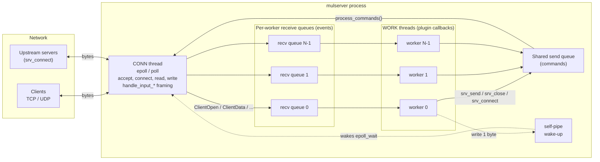
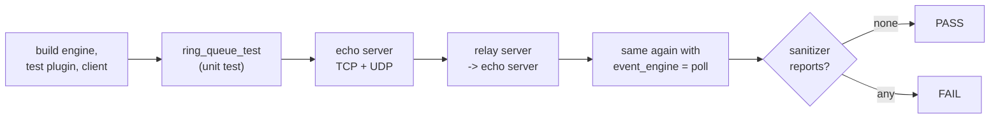

# simple-c++-multithread-reactor-server

**English** | [简体中文](README.zh-CN.md)

A multithreaded C++ server framework built on the **Reactor pattern** (C++11, Linux / macOS).
Business logic is written as a plugin shared library (`.so`); the framework does all network I/O,
threading, message framing, buffering, timeouts and logging.

It is the multithreaded successor of an older multi-process framework (asyncsvr / syncsvr): you
develop the same way (implement a few `handle_*` callbacks), but there is no shared memory and no
process juggling, so debugging is much easier.

The project is meant for **learning**: every source file is commented in detail (what each
function does, why, parameters and return values), and the documents below explain the design with
diagrams.

## Documentation

| Document | What you learn |
|---|---|
| [Architecture](docs/en/architecture.md) | Threads, queues, the reactor loop, connection life cycle, back pressure, shutdown — with many diagrams |
| [Plugin guide](docs/en/plugin-guide.md) | Writing a plugin step by step: callbacks, `srv_*` API, framing, outbound connections, relay example |
| [Configuration](docs/en/configuration.md) | Every config key, the bind file, command line, signals, logs |
| [Source code tour](docs/en/source-tour.md) | Which file does what and the recommended reading order |

## The big picture



* **MAIN thread** — reads the config, loads the plugin, waits for signals
  (`SIGINT`/`SIGTERM` stop, `SIGHUP` reopens the log file).
* **CONN thread** (the only network thread) — owns every socket. Non-blocking I/O with epoll (Linux)
  or poll (macOS and others): accept, connect, read, write, splitting byte streams into packages
  with `handle_input_from_client/server`, idle and connect timeouts.
* **WORK threads × N** — run the business callbacks. **Every connection belongs to exactly one
  worker**, so the open → message → close callbacks of one connection always run on the same thread,
  in order. Outbound connections created with `srv_connect()` belong to the worker that created them.
  Plugin state touched only from worker callbacks can live in `thread_local` storage without locks.
* network thread → worker: one ring queue per worker (`ringqueue_length`).
* worker → network thread: one shared command queue (`send_queue_length`); after pushing, the worker
  wakes the network thread through a pipe.

## Plugin interface in one table

A plugin only includes [`MultithreadServer/server_api.h`](MultithreadServer/server_api.h).
All callbacks are optional except `handle_message_from_client`.

| Callback | Thread | Meaning |
|---|---|---|
| `handle_init(argc, argv, thread_type)` | every thread | called once when each thread starts; non-zero aborts the start |
| `handle_fini(thread_type)` | every thread | called on exit |
| `handle_input_from_client(data, len, si)` | CONN | return the length of the first complete package; 0 = need more data; -1 = close. May return more than `len` when the header already tells the total length |
| `handle_message_from_client(data, len, &send, &send_len, si)` | WORK | process one complete package, optionally write a reply; return <0 to close |
| `handle_client_open(&send, &send_len, si)` / `handle_client_close(si)` | WORK | connection opened / closed (exactly once per connection) |
| `handle_input_from_server` / `handle_message_from_server` | CONN / WORK | the same for outbound connections created with `srv_connect()` |
| `handle_server_open(si, error)` / `handle_server_close(si)` | WORK | connect result / close of an outbound connection (`si->last_error` tells why) |
| `handle_write_blocked(si, blocked)` | WORK | unsent data crossed the high watermark / drained below the low one (flow control) |
| `handle_timer(&ms)` | WORK | periodic call in every worker (`timer_interval_ms`) |

Functions the framework exports to plugins (thread safe, asynchronous):

| Function | Meaning |
|---|---|
| `srv_send(si, data, len)` | send data (client connection, outbound connection or UDP peer) |
| `srv_close(si)` / `srv_abort(si)` | close after flushing / close immediately (TCP RST) |
| `srv_shutdown_write(si)` | `shutdown(SHUT_WR)` after flushing (half close) |
| `srv_pause_read(si, paused)` | pause / resume reading (back pressure) |
| `srv_connect(type, proto, addr, flags, tag, &si)` | outbound TCP, UDP, ICMP ping socket or raw socket. `SRV_CONNECT_HALF_CLOSE` delivers the peer FIN as an empty message instead of closing |
| `srv_set_user_tag(si, tag)` | attach a tag, reported later as `si->user_tag` |
| `srv_log(level, fmt, ...)` and `LOG_INFO` etc. | write to the framework log |
| `srv_conf_string` / `srv_conf_int` | read your own keys from the same config file |
| `srv_worker_id` / `srv_worker_count` / `srv_max_packet_size` | runtime information |

Identify connections by `SocketInfo::conn_id` (unique for the process lifetime); the OS reuses fds.

A minimal echo plugin:

```cpp
#include <arpa/inet.h>
#include <cstring>
#include "server_api.h"

// Framing: [uint32 total length, big endian][payload]
extern "C" int handle_input_from_client(const char* data, int len, const SocketInfo*) {
    if (len < 4) return 0;                  // header incomplete: wait for more bytes
    uint32_t total;
    memcpy(&total, data, 4);
    return (int)ntohl(total);               // may be > len: the engine waits for the rest
}

extern "C" int handle_message_from_client(const char* data, int len, char** send, int* send_len,
                                          const SocketInfo* si) {
    LOG_DEBUG("%d bytes from conn %llu", len, (unsigned long long)si->conn_id);
    memcpy(*send, data, len);               // *send points to a srv_max_packet_size() buffer
    *send_len = len;                        // the engine sends it back for us
    return 0;
}
```

The complete example is [`TestHandler/dll_interface.cpp`](TestHandler/dll_interface.cpp):
`test_mode = echo` is an echo server, `test_mode = relay` transparently relays every client to
another server (shows `srv_connect`, half close and flow control). A larger real-world plugin is the
server of [simple-android-vpn](https://github.com/kingo132/simple-android-vpn): a user-space
TCP/UDP/ICMP proxy.

## Build

```bash
# Makefiles
make -C MultithreadServer            # -> MultithreadServer/mulserver
make -C TestHandler                  # -> TestHandler/libtesthandler.so
make -C TestClient                   # -> TestClient/tcp_test_client
make -C MultithreadServer SANITIZE=address   # or thread / undefined

# or CMake (other projects can add_subdirectory() it and build plugins with reactor_add_plugin())
cmake -B build && cmake --build build -j
cmake -G Xcode -B build-xcode         # Xcode project on macOS
```

## Run

```bash
cd TestHandler
../MultithreadServer/mulserver conf/server_config.ini ./libtesthandler.so
../TestClient/tcp_test_client -c 20 -n 1000 -s 8192        # TCP, 20 clients
../TestClient/tcp_test_client -u -c 10 -n 100 -s 1400      # UDP
```

`mulserver [config file] [plugin path]`; the plugin path can also be set with `dll_file` in the config.
All configuration keys are described in [docs/en/configuration.md](docs/en/configuration.md).

## Tests

```bash
tests/run_tests.sh                    # ring queue unit test + echo/relay/UDP + epoll/poll
SANITIZE=address tests/run_tests.sh   # ASan
SANITIZE=thread  tests/run_tests.sh   # TSan
```



## Fixed compared to the previous version

* Ring queue corrupted data on wrap-around (payload overwrote the header when it crossed the end;
  reads went out of bounds) → padding blocks keep every block contiguous.
* Workers popped from one shared queue, so messages of one TCP connection were processed out of order
  by different threads → one queue per worker, connections pinned to a worker.
* The network thread did `epoll_wait(100ms)` and then `wait_and_pop(100ms)`, sending one message per
  round with up to 200 ms latency → pipe wake-up, all commands processed every round.
* Blocking sockets: a large package blocked the whole network thread → everything non-blocking, with
  send buffers and EPOLLOUT.
* `SIGPIPE` was not ignored (writing to a closed peer killed the process); no signal handlers in
  foreground mode.
* `log_size` was read as `DEFAULT_LOG_MAXFILES` (10 bytes), rotating on every line; the log directory
  was not created.
* `dlerror()` printed with `%d`; function pointers of missing callbacks were garbage.
* TCP accept stored the client address in `local_ip`; UDP bind sockets were never treated as clients,
  so UDP replies were never sent.
* `remove_client` freed `ClientInfo` that was still used afterwards; elements were erased while
  iterating the connection table.
* No `SO_REUSEADDR`; `listen` backlog of 10; no IPv6.
* `send_data` of a worker reply was never empty, so zero-length replies were queued.
* The test plugin read the length in host byte order while the client used network byte order; the
  test client assumed one `recv` returns a whole reply.
* New: outbound connections, half close, flow control callbacks, pause read, idle/connect timeouts,
  poll backend, CMake, test scripts.

Directories: `MultithreadServer/` engine, `TestHandler/` test plugin and config, `TestClient/` load
test client, `tests/` test scripts, `docs/` documentation. The old `MultithreadServer.bak20241021/`
backup and the Xcode project were removed (both are in the git history; an Xcode project can be
generated with `cmake -G Xcode`).
