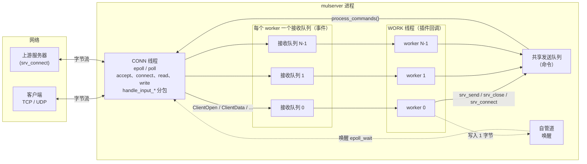
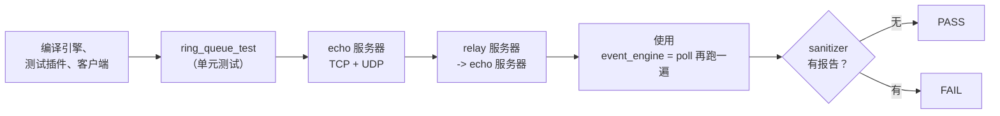

# simple-c++-multithread-reactor-server

[English](README.md) | **简体中文**

一个基于 **Reactor 模式** 的多线程 C++ 服务器框架（C++11，Linux / macOS）。
业务逻辑以插件共享库（`.so`）的形式编写；网络 I/O、线程、消息分包、缓冲、超时和日志全部由框架负责。

它是一个更早的多进程框架（asyncsvr / syncsvr）的多线程继任者：开发方式与之相同（实现几个
`handle_*` 回调即可），但没有共享内存，也不用管理多个进程，因此调试要容易得多。

本项目以 **学习** 为目的：每个源文件都有详细注释（每个函数做什么、为什么这样做、参数和返回值），
下面的文档还配有大量图示来讲解设计。

## 文档

| 文档 | 你将学到 |
|---|---|
| [架构](docs/zh-CN/architecture.md) | 线程、队列、reactor 循环、连接生命周期、背压、停止流程，配有大量图示 |
| [插件开发指南](docs/zh-CN/plugin-guide.md) | 一步步编写插件：回调、`srv_*` API、分包、对外连接、转发（relay）示例 |
| [配置](docs/zh-CN/configuration.md) | 所有配置项、bind 文件、命令行、信号、日志 |
| [源码导读](docs/zh-CN/source-tour.md) | 每个文件的职责以及推荐的阅读顺序 |

## 全局概览



* **MAIN 线程** —— 读取配置、加载插件、等待信号
  （`SIGINT`/`SIGTERM` 停止服务，`SIGHUP` 重新打开日志文件）。
* **CONN 线程**（唯一的网络线程）—— 拥有所有 socket。使用 epoll（Linux）或 poll（macOS 等）进行
  非阻塞 I/O：accept、connect、read、write，借助 `handle_input_from_client/server` 把字节流切分成
  数据包，以及处理空闲超时和连接超时。
* **WORK 线程 × N** —— 执行业务回调。**每个连接只属于一个 worker**，因此同一连接的
  open → message → close 回调总是在同一个线程上按顺序执行。用 `srv_connect()` 创建的对外连接属于
  创建它的那个 worker。只在 worker 回调中访问的插件状态可以放在 `thread_local` 存储中，无需加锁。
* 网络线程 → worker：每个 worker 一个环形队列（`ringqueue_length`）。
* worker → 网络线程：一个共享的命令队列（`send_queue_length`）；worker 入队后通过管道唤醒网络线程。

## 一张表看懂插件接口

插件只需包含 [`MultithreadServer/server_api.h`](MultithreadServer/server_api.h)。
除 `handle_message_from_client` 外，所有回调都是可选的。

| 回调 | 线程 | 含义 |
|---|---|---|
| `handle_init(argc, argv, thread_type)` | 所有线程 | 每个线程启动时调用一次；返回非 0 则中止启动 |
| `handle_fini(thread_type)` | 所有线程 | 退出时调用 |
| `handle_input_from_client(data, len, si)` | CONN | 返回第一个完整数据包的长度；0 = 需要更多数据；-1 = 关闭连接。当包头已经给出总长度时，可以返回大于 `len` 的值 |
| `handle_message_from_client(data, len, &send, &send_len, si)` | WORK | 处理一个完整的数据包，可选地写入回复；返回 <0 则关闭连接 |
| `handle_client_open(&send, &send_len, si)` / `handle_client_close(si)` | WORK | 连接建立 / 关闭（每个连接恰好一次） |
| `handle_input_from_server` / `handle_message_from_server` | CONN / WORK | 同上，用于 `srv_connect()` 创建的对外连接 |
| `handle_server_open(si, error)` / `handle_server_close(si)` | WORK | 对外连接的连接结果 / 关闭（`si->last_error` 给出原因） |
| `handle_write_blocked(si, blocked)` | WORK | 未发送数据超过高水位 / 降到低水位以下（流量控制） |
| `handle_timer(&ms)` | WORK | 在每个 worker 中周期性调用（`timer_interval_ms`） |

框架导出给插件的函数（线程安全、异步）：

| 函数 | 含义 |
|---|---|
| `srv_send(si, data, len)` | 发送数据（客户端连接、对外连接或 UDP 对端） |
| `srv_close(si)` / `srv_abort(si)` | 发完缓冲数据后关闭 / 立即关闭（TCP RST） |
| `srv_shutdown_write(si)` | 发完缓冲数据后执行 `shutdown(SHUT_WR)`（半关闭） |
| `srv_pause_read(si, paused)` | 暂停 / 恢复读取（背压） |
| `srv_connect(type, proto, addr, flags, tag, &si)` | 对外 TCP、UDP、ICMP ping socket 或原始 socket。`SRV_CONNECT_HALF_CLOSE` 会把对端的 FIN 作为一条空消息交付，而不是直接关闭连接 |
| `srv_set_user_tag(si, tag)` | 附加一个标签，之后通过 `si->user_tag` 返回 |
| `srv_log(level, fmt, ...)` 以及 `LOG_INFO` 等 | 写入框架日志 |
| `srv_conf_string` / `srv_conf_int` | 从同一个配置文件中读取你自己的配置项 |
| `srv_worker_id` / `srv_worker_count` / `srv_max_packet_size` | 运行时信息 |

请用 `SocketInfo::conn_id`（在进程生命周期内唯一）来标识连接；操作系统会复用 fd。

一个最小的 echo 插件：

```cpp
#include <arpa/inet.h>
#include <cstring>
#include "server_api.h"

// 分包格式：[uint32 总长度，大端序][payload]
extern "C" int handle_input_from_client(const char* data, int len, const SocketInfo*) {
    if (len < 4) return 0;                  // 包头不完整：等待更多字节
    uint32_t total;
    memcpy(&total, data, 4);
    return (int)ntohl(total);               // 可能 > len：引擎会等待剩余部分
}

extern "C" int handle_message_from_client(const char* data, int len, char** send, int* send_len,
                                          const SocketInfo* si) {
    LOG_DEBUG("%d bytes from conn %llu", len, (unsigned long long)si->conn_id);
    memcpy(*send, data, len);               // *send 指向一个 srv_max_packet_size() 大小的缓冲区
    *send_len = len;                        // 引擎会替我们把它发回去
    return 0;
}
```

完整示例见 [`TestHandler/dll_interface.cpp`](TestHandler/dll_interface.cpp)：
`test_mode = echo` 是一个 echo 服务器，`test_mode = relay` 会把每个客户端透明地转发到另一台服务器
（演示了 `srv_connect`、半关闭和流量控制）。一个更大的真实插件是
[simple-android-vpn](https://github.com/kingo132/simple-android-vpn) 的服务端：一个用户态的
TCP/UDP/ICMP 代理。

## 编译

```bash
# Makefile
make -C MultithreadServer            # -> MultithreadServer/mulserver
make -C TestHandler                  # -> TestHandler/libtesthandler.so
make -C TestClient                   # -> TestClient/tcp_test_client
make -C MultithreadServer SANITIZE=address   # 或 thread / undefined

# 或者 CMake（其他项目可以 add_subdirectory() 引入，并用 reactor_add_plugin() 编译插件）
cmake -B build && cmake --build build -j
cmake -G Xcode -B build-xcode         # 在 macOS 上生成 Xcode 工程
```

## 运行

```bash
cd TestHandler
../MultithreadServer/mulserver conf/server_config.ini ./libtesthandler.so
../TestClient/tcp_test_client -c 20 -n 1000 -s 8192        # TCP，20 个客户端
../TestClient/tcp_test_client -u -c 10 -n 100 -s 1400      # UDP
```

`mulserver [配置文件] [插件路径]`；插件路径也可以通过配置中的 `dll_file` 设置。
所有配置项的说明见 [docs/zh-CN/configuration.md](docs/zh-CN/configuration.md)。

## 测试

```bash
tests/run_tests.sh                    # 环形队列单元测试 + echo/relay/UDP + epoll/poll
SANITIZE=address tests/run_tests.sh   # ASan
SANITIZE=thread  tests/run_tests.sh   # TSan
```



## 相比上一版本修复的问题

* 环形队列在回绕时会损坏数据（payload 跨越缓冲区末尾时覆盖了块头；读取越界）
  → 使用填充块（padding）保证每个块在内存中连续。
* 所有 worker 从同一个共享队列取数据，导致同一 TCP 连接的消息被不同线程乱序处理
  → 每个 worker 一个队列，连接固定绑定到一个 worker。
* 网络线程先 `epoll_wait(100ms)` 再 `wait_and_pop(100ms)`，每轮只发送一条消息，延迟最高可达 200 ms
  → 使用管道唤醒，每轮处理所有命令。
* 阻塞 socket：一个大数据包会阻塞整个网络线程 → 全部改为非阻塞，配合发送缓冲区和 EPOLLOUT。
* 没有忽略 `SIGPIPE`（向已关闭的对端写数据会导致进程被杀死）；前台模式下没有信号处理函数。
* `log_size` 被错误地读成了 `DEFAULT_LOG_MAXFILES`（10 字节），导致每写一行就轮转一次；日志目录不会被自动创建。
* `dlerror()` 用 `%d` 打印；未实现的回调对应的函数指针是垃圾值。
* TCP accept 把客户端地址存进了 `local_ip`；UDP 绑定的 socket 从未被当作客户端处理，所以 UDP 回复从来没有发出去。
* `remove_client` 释放了之后仍在使用的 `ClientInfo`；在遍历连接表的同时删除元素。
* 没有设置 `SO_REUSEADDR`；`listen` 的 backlog 只有 10；不支持 IPv6。
* worker 回复中的 `send_data` 永远不为空，导致长度为 0 的回复也被入队。
* 测试插件按主机字节序读取长度，而客户端使用网络字节序；测试客户端假设一次 `recv` 就能收到完整回复。
* 新增：对外连接、半关闭、流量控制回调、暂停读取、空闲/连接超时、poll 后端、CMake、测试脚本。

目录：`MultithreadServer/` 引擎，`TestHandler/` 测试插件和配置，`TestClient/` 压测客户端，
`tests/` 测试脚本，`docs/` 文档。旧的 `MultithreadServer.bak20241021/` 备份和 Xcode 工程已被删除
（两者都保留在 git 历史中；Xcode 工程可以用 `cmake -G Xcode` 生成）。
