# Architecture

**English** | [简体中文](../zh-CN/architecture.md) · [README](../../README.md) · [Plugin guide](plugin-guide.md) · [Configuration](configuration.md) · [Source tour](source-tour.md)

This document explains how the reactor engine works inside: which thread does what, how data flows
from a socket to your plugin and back, and why each design decision was made. Every section links to
the functions that implement it, so you can read the code next to the diagram.

## Contents

1. [Design goals](#1-design-goals)
2. [Threads and queues](#2-threads-and-queues)
3. [Main classes](#3-main-classes)
4. [Start-up](#4-start-up)
5. [The reactor loop](#5-the-reactor-loop)
6. [Handling one ready socket](#6-handling-one-ready-socket)
7. [Life of a TCP client connection](#7-life-of-a-tcp-client-connection)
8. [Framing: from a byte stream to packages](#8-framing-from-a-byte-stream-to-packages)
9. [UDP](#9-udp)
10. [Outbound connections (srv_connect)](#10-outbound-connections-srv_connect)
11. [The send path](#11-the-send-path)
12. [The ring queue](#12-the-ring-queue)
13. [Back pressure](#13-back-pressure)
14. [Interest set: what epoll waits for](#14-interest-set-what-epoll-waits-for)
15. [Connection identity: why conn_id](#15-connection-identity-why-conn_id)
16. [Closing connections](#16-closing-connections)
17. [Worker loop and timer](#17-worker-loop-and-timer)
18. [Timeouts](#18-timeouts)
19. [Shutdown](#19-shutdown)
20. [Logging, daemon mode and signals](#20-logging-daemon-mode-and-signals)

---

## 1. Design goals

| Goal | How it is achieved |
|---|---|
| Plugin code without locks | each connection is pinned to one worker; all its callbacks run there, in order |
| Never block on the network | one network thread with non-blocking sockets and epoll/poll; it never waits on a queue |
| Bounded memory | fixed size ring queues, `send_buffer_max` per connection, back pressure everywhere |
| Low latency | self-pipe wake-up: a worker's command is executed immediately, not on the next poll timeout |
| Safe against races | commands carry `(fd, conn_id)`; stale commands for closed connections are dropped |
| Easy to learn and debug | small code base, one place for each concern, detailed comments, epoll and poll back ends |

The **golden rule**: *only the network thread touches sockets and the connection table.* Everything
else talks to it through queues. This removes almost every possible race.

## 2. Threads and queues

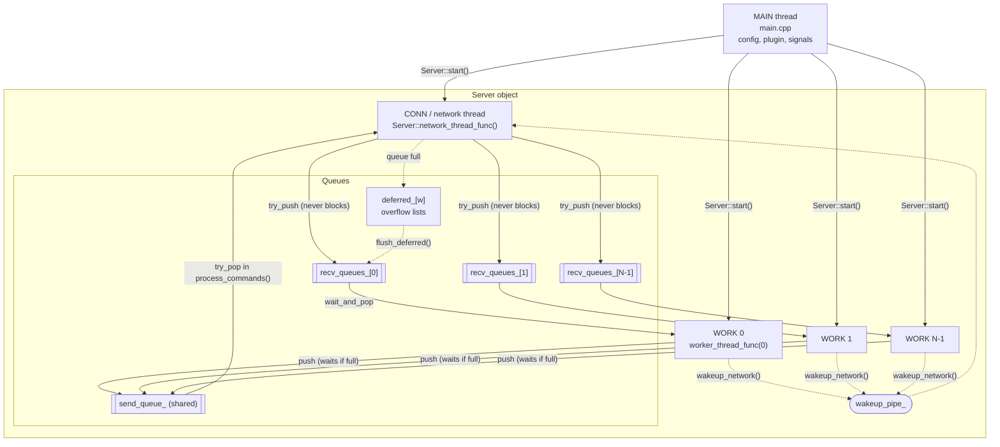

| Thread | Runs | Touches sockets? | Plugin callbacks |
|---|---|---|---|
| MAIN | `main()` | only at start (bind) | `handle_init(MAIN)`, `handle_fini(MAIN)` |
| CONN | `Server::network_thread_func()` | **yes, all of them** | `handle_init(CONN)`, `handle_input_from_client/server`, `handle_fini(CONN)` |
| WORK × N | `Server::worker_thread_func(i)` | only to create a socket in `srv_connect()` | everything else |

Why one queue **per worker** instead of one shared queue? With a shared queue two workers could pop
two messages of the same TCP connection and process them in the wrong order. A per-worker queue plus
"connection → worker" pinning gives ordering for free.

Why one **shared** send queue? Commands from all workers go to the same single consumer (the network
thread), and commands of one worker must stay in order (for example `Register` before `Send`, see
[section 10](#10-outbound-connections-srv_connect)). One FIFO queue guarantees both.

### How a connection is assigned to a worker

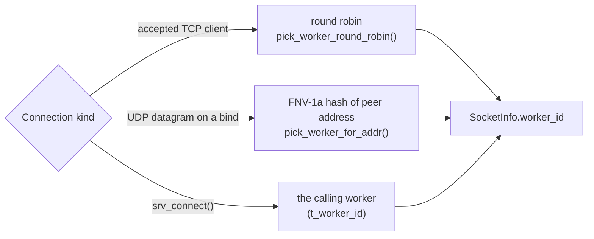

UDP has no connection, so the peer address decides the worker. The hash is stable, so all
datagrams of one peer are processed by the same worker in order.

## 3. Main classes

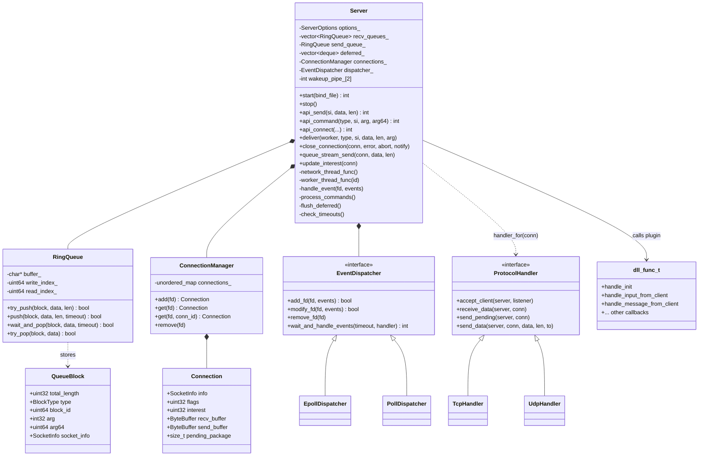

* **Strategy pattern** twice: `EventDispatcher` hides epoll vs poll, `ProtocolHandler` hides TCP vs
  UDP. `Server` code never asks "is this epoll?"; it asks the strategy object.
* `Connection` is the network thread's private view of a socket (buffers, flags). `SocketInfo` is the
  public snapshot copied into every event and given to the plugin.

## 4. Start-up

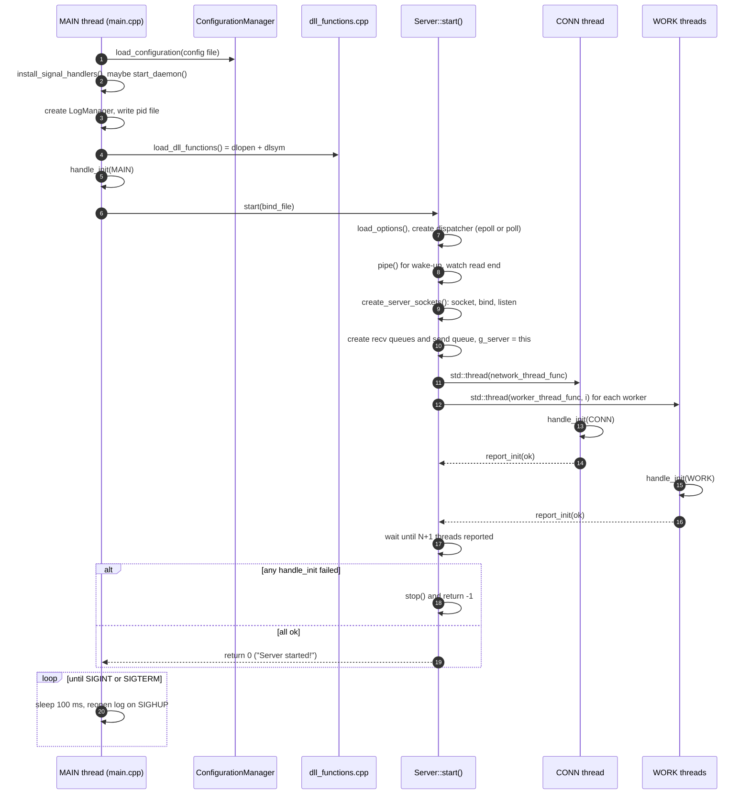

Why bind **before** starting threads? A typical error such as "port already in use" then fails
immediately, before any thread exists that would need to be stopped again.

## 5. The reactor loop

`Server::network_thread_func()` is the heart of the engine. Each round has four steps:

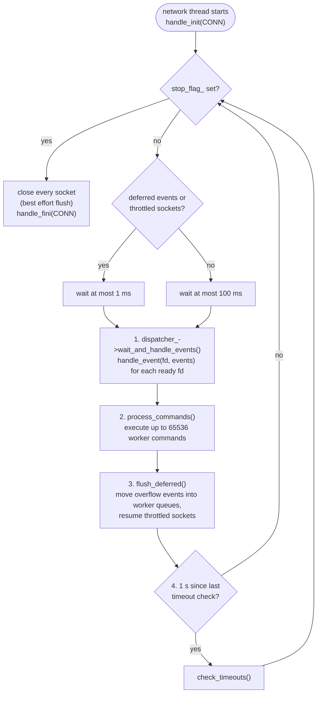

* **Why the 100 ms timeout?** Nothing depends on it for latency (commands wake the loop through the
  pipe); it only bounds how late timeouts and the stop flag are noticed.
* **Why 1 ms when there is backlog?** Workers free queue space without telling the network thread, so
  while something waits for room it polls quickly.
* **Why a limit of 65536 commands per round?** A plugin flooding the send queue must not starve
  socket events (accepts, reads).

### The self-pipe trick

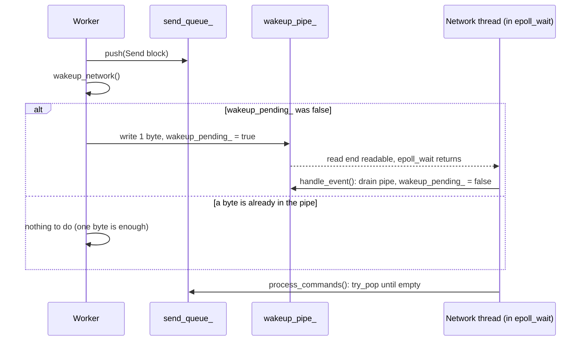

`epoll_wait()`/`poll()` can only wait for file descriptors, not for a condition variable. Writing a
byte into a pipe whose read end is watched turns "a command was queued" into "an fd became
readable". The atomic `wakeup_pending_` flag avoids one `write()` system call per command.

## 6. Handling one ready socket

`Server::handle_event(fd, events)` decides what a readiness event means:

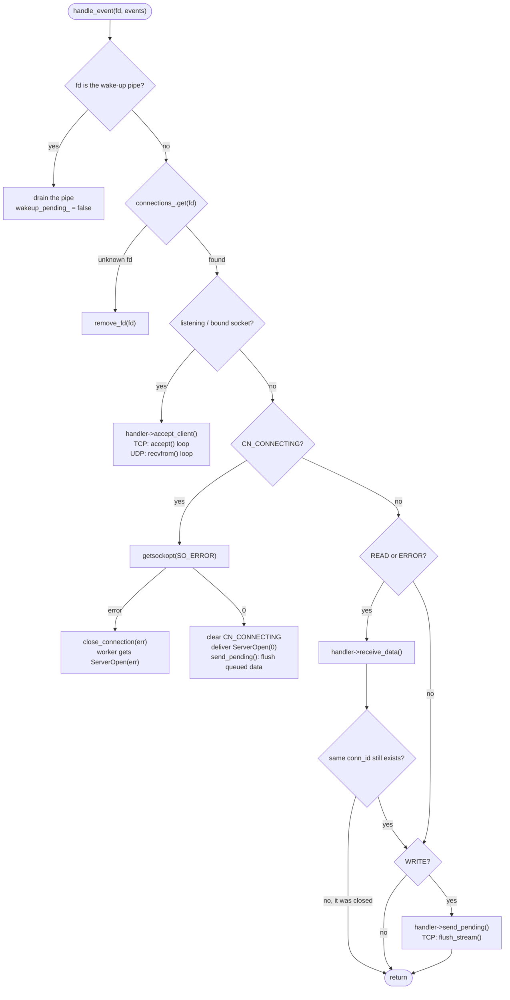

Note the `conn_id` check after reading: `receive_data()` may close the connection, and the fd number
could even be reused by a new connection within the same call. See
[section 15](#15-connection-identity-why-conn_id).

## 7. Life of a TCP client connection

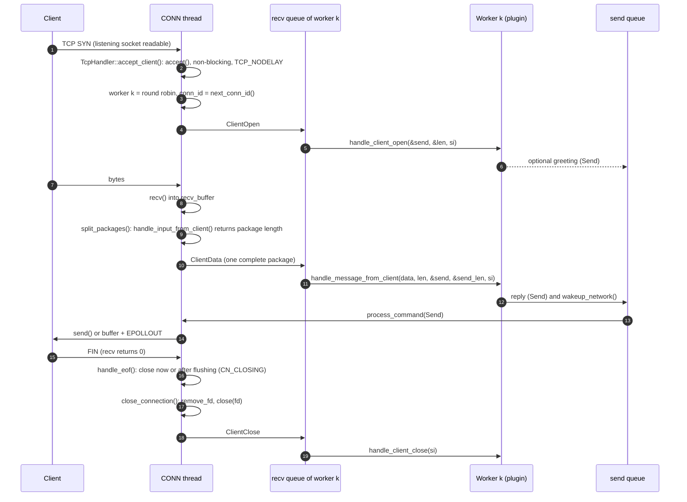

Guarantees the plugin can rely on:

* `handle_client_open` and `handle_client_close` are called **exactly once** per accepted
  connection, on the same worker, and every message comes in between.
* Commands for a connection that has already been closed are dropped silently, so calling
  `srv_send()` "too late" is harmless.

## 8. Framing: from a byte stream to packages

TCP is a byte stream: one `recv()` can return half a message or three messages. The plugin's
`handle_input_from_client()` tells the engine where a package ends. `TcpHandler::split_packages()`:

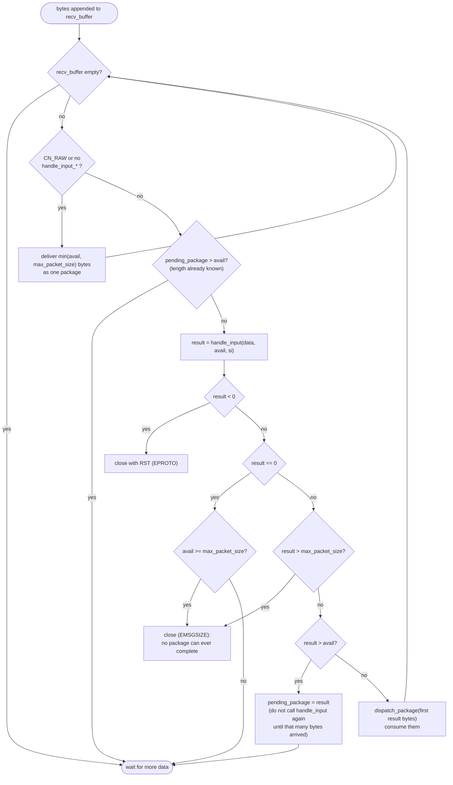

Returning a length **larger than `len`** is allowed and recommended when the header contains the total
length: the engine remembers it in `pending_package` and does not call the plugin again for every
small chunk of a big message.

## 9. UDP

A "udp" line in the bind file creates one bound socket. There is no per-peer connection object:

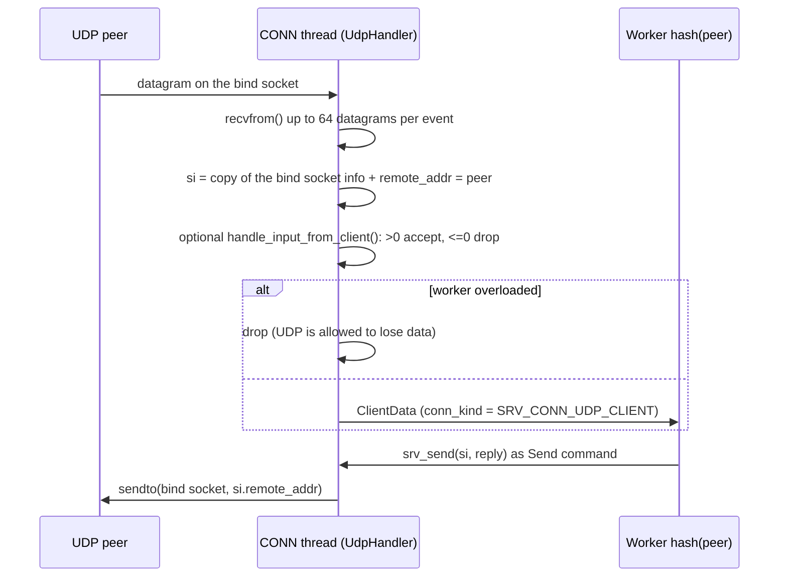

* No `handle_client_open/close` for UDP peers: there is no connection. All peers of one bind share
  the bind socket's `sock_fd` and `conn_id`; identify a UDP peer by `si->remote_addr`.
* A reply is sent from the bind socket to `si->remote_addr` (`process_command` passes `to`).
* When a worker is overloaded, UDP data is **dropped** instead of buffered — that is the nature of UDP
  and protects the server.
* Outbound datagram sockets (`srv_connect(SOCK_DGRAM / SOCK_RAW)`) are "connected" sockets read with
  `recv()`; each datagram is one `ServerData` event. An empty datagram arrives as `len == 0` with a
  non-NULL `data`, so it is never confused with the half-close EOF signal `(NULL, 0)`.

## 10. Outbound connections (srv_connect)

`srv_connect()` creates the socket **in the calling worker thread**, starts a non-blocking
`connect()`, and hands the fd to the network thread with a `Register` command. Why not let the network
thread create it? Because the worker immediately gets a complete `SocketInfo` (fd + `conn_id`) and can
`srv_send()` data right away; since commands from one thread stay in order, `Register` is always
executed before those `Send` commands.

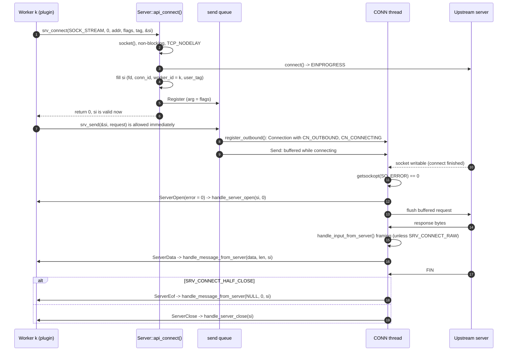

State machine of an outbound connection as the plugin sees it:

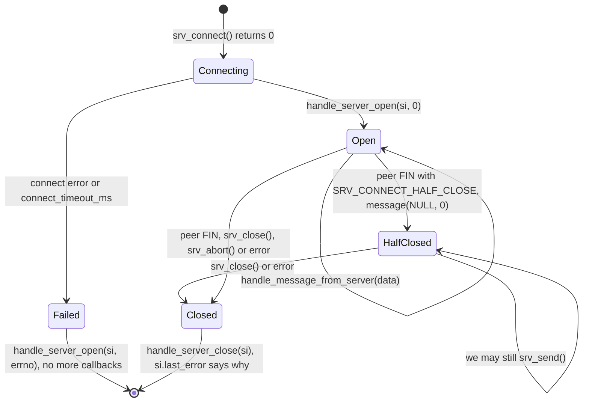

`srv_connect()` supports more than TCP:

| sock_type / protocol | Use |
|---|---|
| `SOCK_STREAM, 0` | TCP client |
| `SOCK_DGRAM, 0` | connected UDP socket (each datagram one message) |
| `SOCK_DGRAM, IPPROTO_ICMP` | unprivileged ICMP "ping socket" (Linux `net.ipv4.ping_group_range`, macOS) |
| `SOCK_RAW, IPPROTO_ICMP` | raw ICMP (needs root / CAP_NET_RAW) |

`user_tag` is a free 64-bit value attached to the connection. The relay example stores the client's
`conn_id` there so that `handle_message_from_server` can find the matching client.

## 11. The send path

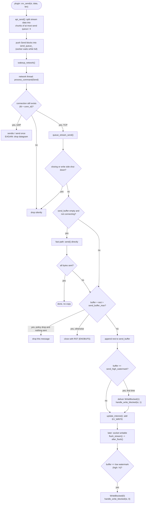

`after_flush()` also completes actions that wait for an empty buffer:

| Flag | Set by | Done when the buffer is empty |
|---|---|---|
| `CN_CLOSING` | `srv_close()`, peer FIN with pending data | `close_connection()` |
| `CN_SHUTDOWN_WR` | `srv_shutdown_write()` | `shutdown(SHUT_WR)` → our FIN, flag `CN_WR_SHUT_DONE` |
| `CN_WRITE_BLOCKED` | high watermark reached | `WriteBlocked(0)` below the low watermark |

## 12. The ring queue

`RingQueue` (`ring_queue.h/.cpp`) is a bounded FIFO of variable sized blocks stored in **one
contiguous byte buffer**, allocated once. Each block is a `QueueBlock` header followed by the payload,
rounded up to 8 bytes.

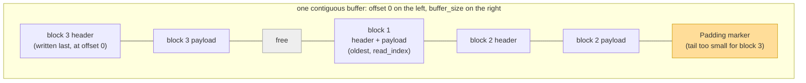

*Buffer after wrapping around: block 3 did not fit behind block 2, so the tail was filled with a
Padding marker and block 3 was written at offset 0. Readers skip the marker.*

`write_index_` and `read_index_` are 64-bit byte counters that only grow; the position in the buffer is
`index % buffer_size`, and `write_index_ - read_index_` is the used space. Push algorithm:

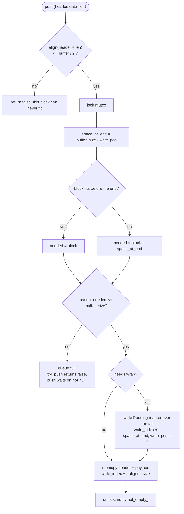

Why at most **half** of the buffer per block? In the worst case a block needs the padding in front of
it plus its own size; limiting blocks to half the buffer guarantees that, once the queue drains, any
block can always be stored. `load_options()` therefore makes every queue at least
`2 × (max_packet_size + header)`.

Why notify **after** unlocking? A woken consumer would otherwise immediately block on the mutex the
producer still holds.

## 13. Back pressure

A fast producer must never make memory grow without bound. The engine has several levels:

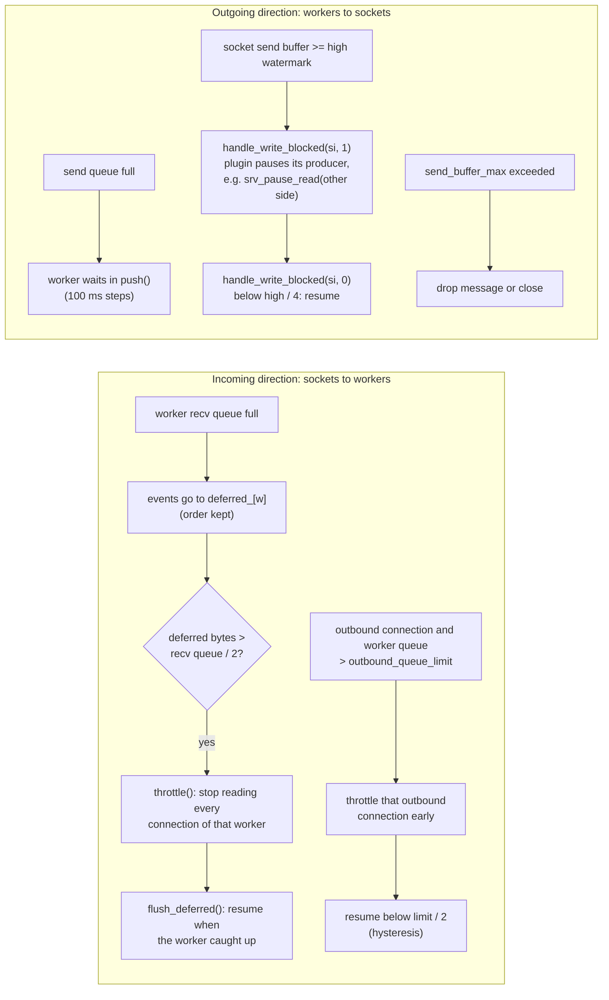

Why throttle outbound connections **earlier** (`outbound_queue_limit`)? In a proxy, upstream servers
can deliver megabytes per second while clients send small messages (requests, TCP ACKs relayed by a
VPN). Without the early limit those small, latency-critical client messages would wait behind
megabytes of server data in the same worker queue (head-of-line blocking).

The relay example closes the loop end to end:

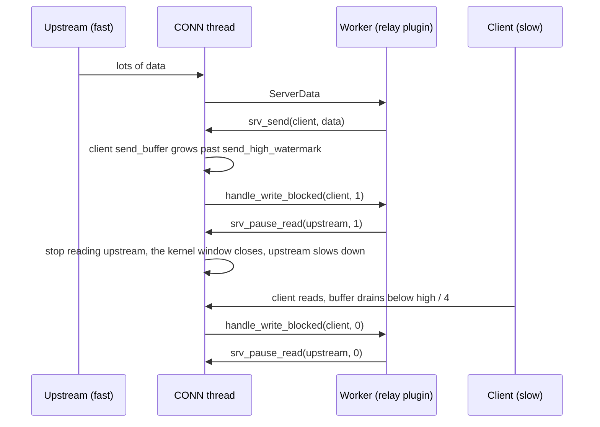

## 14. Interest set: what epoll waits for

`Server::update_interest()` is the **only** place that decides which events are registered. The set is
derived from the connection state every time something changes:

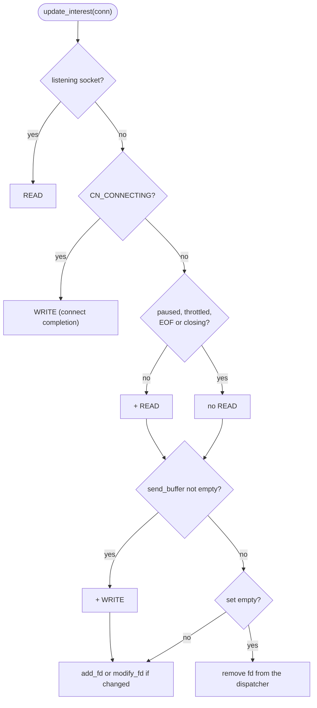

* WRITE interest only while there is unsent data: an idle socket is *always* writable, so permanent
  WRITE interest would make the loop spin at 100 % CPU.
* An **empty** interest set removes the fd from epoll entirely. With epoll, `EPOLLERR`/`EPOLLHUP`
  are always reported even if not requested; a half-closed socket we do not want to read would
  otherwise wake the loop forever.
* Both back ends are level-triggered: an event is reported again as long as the condition holds, so
  the handlers may stop early (for example after 256 accepts) without losing anything.

## 15. Connection identity: why conn_id

The kernel reuses fd numbers immediately. A command queued by a worker can arrive after its
connection was closed and the same fd was given to a new client:

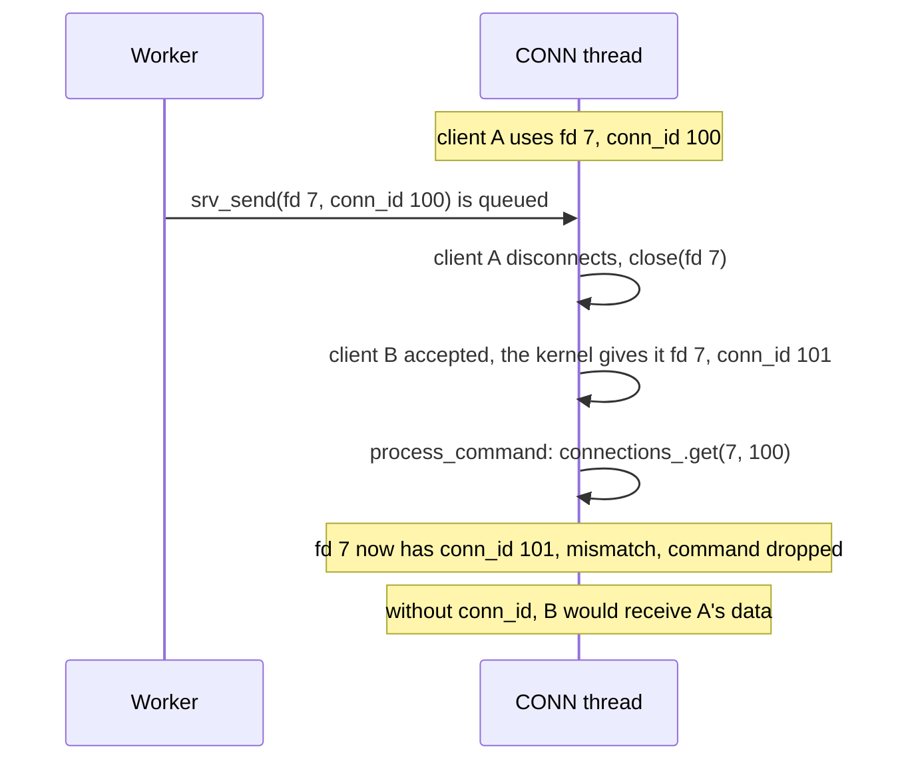

That is why `ConnectionManager::get(fd, conn_id)` is used for every command, why `handle_event()`
re-checks after reading, and why plugins must key their tables by `conn_id`, never by fd.

## 16. Closing connections

`Server::close_connection()` is the single place where sockets are closed. It guarantees exactly one
"closed" notification per connection:

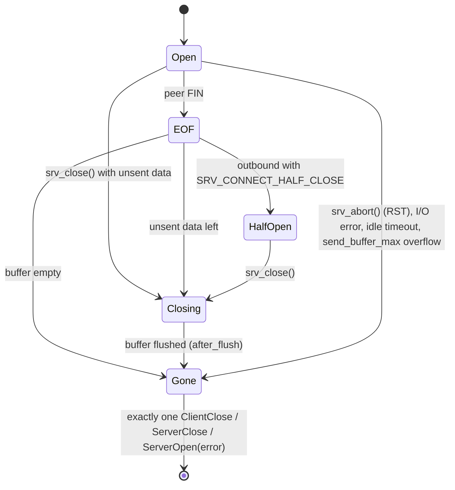

| Situation | Event the worker receives |
|---|---|
| accepted client closed | `ClientClose` → `handle_client_close` |
| outbound connection closed after it was open | `ServerClose` → `handle_server_close` |
| outbound connect never completed | `ServerOpen(error)` → `handle_server_open(si, errno)` |
| engine shutdown | nothing (workers are stopping) |

`srv_abort()` sets `SO_LINGER` with timeout 0 before `close()`, which makes the kernel send a TCP
**RST** and discard unsent data, instead of the normal FIN handshake.

## 17. Worker loop and timer

```mermaid
flowchart TD
    S(["worker_thread_func(i)<br/>t_worker_id = i, handle_init(WORK)"]) --> L{"stop flag?"}
    L -->|"yes"| F(["handle_fini(WORK)"])
    L -->|"no"| W["wait_ms = time until next timer tick (max 100)"]
    W --> POP["recv_queue.wait_and_pop(wait_ms)"]
    POP -->|"got event"| PB["process_block(): call the matching callback<br/>reply in send_data is sent with api_send()<br/>negative result is a Close command"]
    POP -->|"timeout"| T
    PB --> T{"timer interval elapsed?"}
    T -->|"yes"| HT["handle_timer(&ms)<br/>plugin may change the interval"]
    T -->|"no"| L
    HT --> L
```

| Event type | Callback |
|---|---|
| `ClientOpen` | `handle_client_open(&send, &send_len, si)` |
| `ClientData` | `handle_message_from_client(data, len, &send, &send_len, si)` |
| `ClientClose` | `handle_client_close(si)` |
| `ServerOpen` | `handle_server_open(si, error)` |
| `ServerData` | `handle_message_from_server(data, len, si)` — `data` is never NULL, even for an empty datagram |
| `ServerEof` | `handle_message_from_server(NULL, 0, si)` |
| `ServerClose` | `handle_server_close(si)` |
| `WriteBlocked` | `handle_write_blocked(si, blocked)` |

## 18. Timeouts

`check_timeouts()` runs about once per second on the network thread:

* **Connect timeout** — an outbound socket still `CN_CONNECTING` after `connect_timeout_ms` is closed
  with `ETIMEDOUT` (the plugin gets `handle_server_open(si, ETIMEDOUT)`).
* **Idle timeout** — an accepted client without received data for the bind's idle timeout (fourth
  column of the bind file, seconds, 0 = never) is closed with `ETIMEDOUT`.

A linear scan once per second is cheap even for tens of thousands of connections and far simpler
than a timer wheel.

## 19. Shutdown

```mermaid
sequenceDiagram
    autonumber
    participant OS as Signal (SIGINT or SIGTERM)
    participant M as MAIN thread
    participant S as Server::stop()
    participant N as CONN thread
    participant W as WORK threads
    OS->>M: handler sets stop_signal = 1
    M->>S: server.stop()
    S->>S: started_.exchange(false) (idempotent)
    S->>S: stop_flag_ = true
    S->>N: wakeup_network()
    N->>N: loop ends, flush send buffers (best effort)
    N->>N: close every socket, no events to workers
    N->>N: handle_fini(CONN)
    S->>N: join()
    S->>W: notify_all() on every queue
    W->>W: loop ends, handle_fini(WORK)
    S->>W: join()
    M->>M: handle_fini(MAIN), remove pid file, exit
```

The network thread stops **first**, so no new event can be produced for workers that are exiting.
The plugin is deliberately not `dlclose()`d: `thread_local` destructors registered by the plugin
may still run at process exit.

## 20. Logging, daemon mode and signals

```mermaid
flowchart LR
    A["LOG_INFO(...) in engine or plugin"] --> B{"level <= log_level?"}
    B -->|"no"| X["ignored (LOG_DEBUG / LOG_TRACE<br/>skip formatting entirely)"]
    B -->|"yes"| C["format: time, level, thread name"]
    C --> D{"log_dest"}
    D -->|"1"| T["terminal"]
    D -->|"2"| F["file log_dir/prefix + server.log"]
    D -->|"3"| T & F
    F --> R{"file > log_size?"}
    R -->|"yes"| ROT["rotate: server.log.1 ... log_maxfiles"]
```

* `run_mode = background` daemonizes with the classic **double fork + setsid()** before any thread is
  created (forking a multithreaded process only copies the calling thread).
* Signals: `SIGINT`/`SIGTERM` set a flag polled by the main thread, `SIGHUP` reopens the log file (for
  external log rotation), `SIGPIPE` is ignored so that writing to a closed socket returns `EPIPE`
  instead of killing the process.
* Each thread has a name (`main`, `conn`, `work-0` …) that appears in every log line, which makes it
  easy to see which thread did what.
