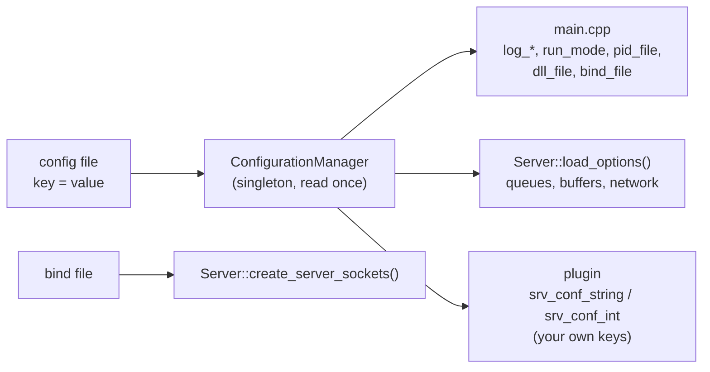

# Configuration

**English** | [简体中文](../zh-CN/configuration.md) · [README](../../README.md) · [Architecture](architecture.md) · [Plugin guide](plugin-guide.md) · [Source tour](source-tour.md)

## Command line

```bash
mulserver [config_file] [plugin_path]
mulserver -h
```

| Argument | Default | Meaning |
|---|---|---|
| `config_file` | `./config.ini` | configuration file (format below) |
| `plugin_path` | `dll_file` from the config, else `./libhandler.so` | plugin shared library |

All arguments are also passed to every `handle_init(argc, argv, thread_type)` call.

## How the configuration is used



The file is read **once at start**; changing it needs a restart. Plugins can read their own keys from
the same file, so one file configures engine and business logic together.

## File format

```ini
# comment ('#' or ';' at the line start or after whitespace)
[section]            ; section headers are ignored (all keys are global)
key = value          # spaces around '=' are trimmed
worker_num = 0x10    # integers accept decimal, 0x hex and 0 octal (strtoll base 0)
tcp_nodelay = yes    # booleans: 1 / true / yes / on, anything else is false
```

## Keys

### Logging

| Key | Default | Meaning |
|---|---|---|
| `log_dir` | `./log` | log directory (created if missing) |
| `log_level` | `6` | 0 emerg, 1 alert, 2 crit, 3 error, 4 warn, 5 notice, 6 info, 7 debug, 8 trace |
| `log_dest` | `3` | 1 terminal, 2 file, 3 both |
| `log_size` | `104857600` (100 MB) | rotate when the file grows beyond this |
| `log_maxfiles` | `10` | rotated files kept: `server.log.1` … |
| `log_prefix` | empty | file name becomes `<prefix>server.log` |

### Process

| Key | Default | Meaning |
|---|---|---|
| `run_mode` | `foreground` | `background` = daemon (double fork + setsid) |
| `pid_file` | empty | write the pid here (removed on exit) |
| `worker_num` | `4` | number of worker threads (at least 1) |
| `bind_file` | `./conf/bind.txt` | listening addresses (see below) |
| `dll_file` | `./libhandler.so` | plugin, if not given on the command line |

### Queues and buffers

| Key | Default | Meaning |
|---|---|---|
| `max_packet_size` | `65536` | largest package / message (1 B … 64 MB) |
| `ringqueue_length` | `8388608` (8 MB) | bytes of **each** worker's receive queue |
| `send_queue_length` | `16777216` (16 MB) | bytes of the shared worker → network command queue |
| `recv_buffer` | `65536` | bytes read per `recv()` call (at least 1024) |
| `send_buffer_max` | `67108864` (64 MB) | unsent bytes allowed per connection |
| `send_overflow_policy` | `close` | above `send_buffer_max`: `close` the connection or `drop` the message |
| `send_high_watermark` | `1048576` (1 MB) | `handle_write_blocked(si, 1)` above, `(si, 0)` below a quarter of it |
| `outbound_queue_limit` | `1048576` (1 MB) | stop reading outbound connections when their worker queue holds more |

Both queue sizes are raised automatically to at least `2 × (max_packet_size + header) + 4096`, because a
block may take at most half of a ring queue (see
[Architecture § 12](architecture.md#12-the-ring-queue)).

### Network

| Key | Default | Meaning |
|---|---|---|
| `listen_backlog` | `1024` | `listen()` backlog |
| `connect_timeout_ms` | `10000` | timeout of `srv_connect()` |
| `tcp_nodelay` | `1` | disable Nagle on accepted and outbound TCP sockets |
| `max_connections` | `100000` | accepted clients above this are closed immediately |
| `timer_interval_ms` | `100` | default `handle_timer` period |
| `event_engine` | `epoll` on Linux, `poll` elsewhere | readiness back end |

## Bind file

One listening address per line: `ip port tcp|udp [idle_timeout_seconds]`.

```text
#ip          #port   #type   #idle timeout (seconds, 0 = never)
0.0.0.0      12345   tcp     60
0.0.0.0      12345   udp     0
::           12345   tcp     60
```

* `::` binds IPv6 only (`IPV6_V6ONLY`), so `0.0.0.0` can be bound to the same port separately.
* The idle timeout applies to accepted TCP clients of that line.
* Every socket gets `SO_REUSEADDR` so a restart works while old connections are in `TIME_WAIT`.

## Signals

| Signal | Effect |
|---|---|
| `SIGINT`, `SIGTERM` | graceful stop (see [Architecture § 19](architecture.md#19-shutdown)) |
| `SIGHUP` | reopen the log file (after external log rotation, e.g. logrotate) |
| `SIGPIPE` | ignored (writes to a closed socket return `EPIPE`) |

## Log line format

```text
[2026-10-12 10:00:00.123] [INFO] [work-2] Worker 2 processed 1000 messages
 timestamp                 level  thread  message
```

Thread names: `main`, `conn`, `work-0` … `work-N-1`.

## Tuning tips

| Symptom | Try |
|---|---|
| "Worker N queue full, deferred" in trace logs | more workers, a faster plugin, or a bigger `ringqueue_length` |
| Proxy clients see high latency while downloading | lower `outbound_queue_limit` |
| Connections closed with `ENOBUFS` | the peer reads too slowly: react to `handle_write_blocked`, or raise `send_buffer_max` |
| Many connections on macOS | `event_engine = poll` is the only choice there; keep connection counts moderate |
| Debugging | `log_level = 8`, `worker_num = 1`, `log_dest = 1` |
