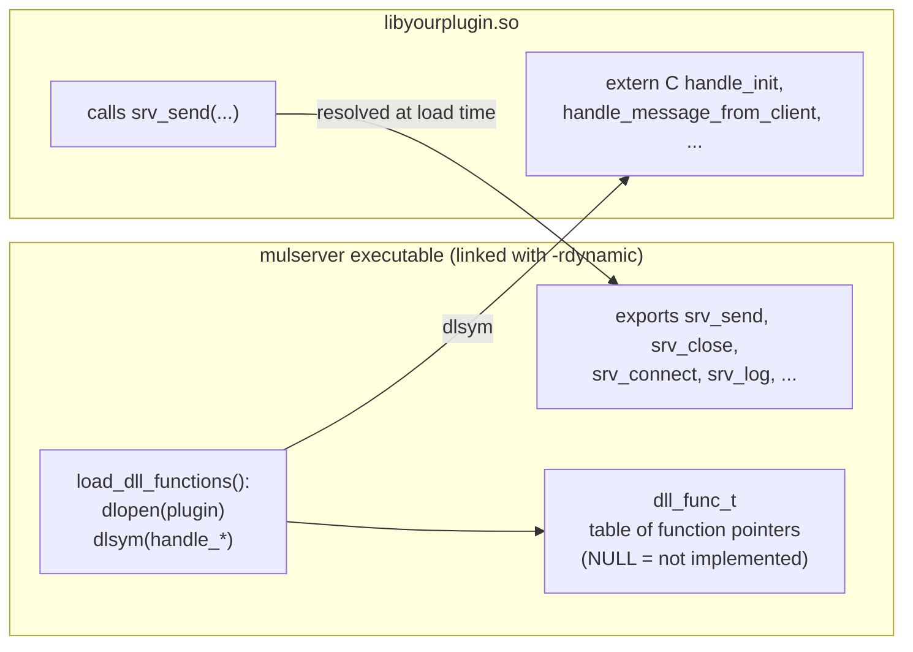
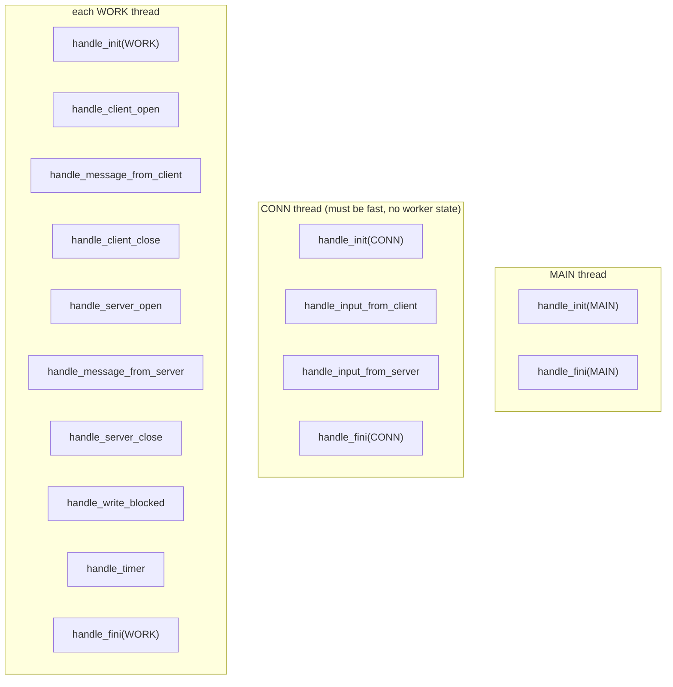
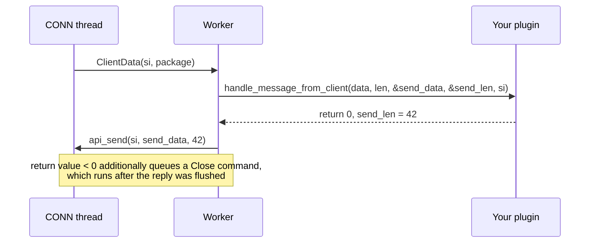
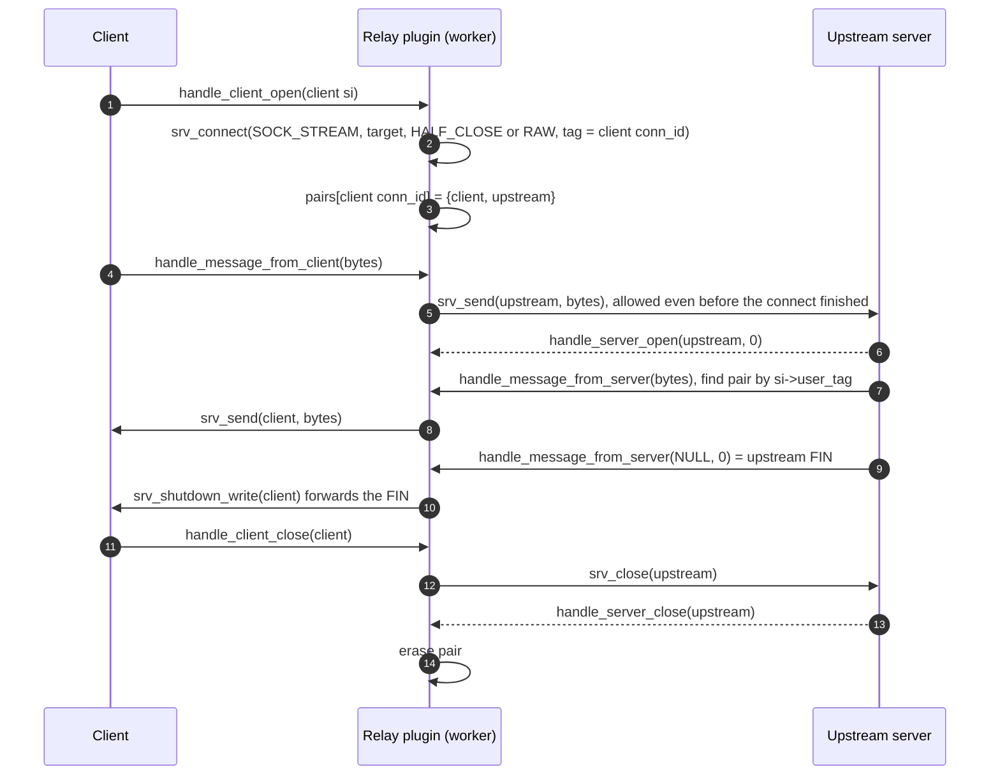

# Plugin guide

**English** | [简体中文](../zh-CN/plugin-guide.md) · [README](../../README.md) · [Architecture](architecture.md) · [Configuration](configuration.md) · [Source tour](source-tour.md)

A plugin is a shared library that the engine loads with `dlopen()`. You write the business logic as a
few C callbacks; the engine does everything else. This guide builds a plugin step by step and
explains the rules you must know.

## 1. How the engine and the plugin find each other



* Callbacks must be declared `extern "C"` so their names are not C++-mangled and `dlsym()` finds them.
* The `srv_*` functions live in the executable. `-rdynamic` (CMake: `ENABLE_EXPORTS ON`) puts them in
  the dynamic symbol table so the plugin can call them. On macOS plugins are linked with
  `-undefined dynamic_lookup` for the same reason.
* Missing callbacks are simply `NULL` in the table and skipped. Only `handle_message_from_client` is
  mandatory.

## 2. Which callback runs where



Rules that follow from this:

1. `handle_input_*` runs on the network thread. Keep it short (only look at the header) and do not
   access per-worker state.
2. Everything a connection does happens on **one** worker. Keep per-connection state in a
   `thread_local` table keyed by `conn_id` — no mutex needed.
3. Global state written in `handle_init(MAIN)` (before any other thread starts) can be read by every
   thread without locks.

## 3. Step 1 — framing

Decide how a package looks on the wire. The test plugin uses `[uint32 total length][uint32 seq][payload]`
in network byte order. Tell the engine where a package ends:

```cpp
extern "C" int handle_input_from_client(const char* data, int len, const SocketInfo* si) {
    if (len < 8) return 0;                       // header not complete: wait
    uint32_t total;
    memcpy(&total, data, 4);                     // memcpy: data may be unaligned
    total = ntohl(total);                        // network -> host byte order
    if (total < 8 || total > (uint32_t)srv_max_packet_size())
        return -1;                               // garbage: the engine closes the connection
    return (int)total;                           // may be larger than len
}
```

| Return value | Meaning |
|---|---|
| `> 0` | length of the first complete package (may exceed `len`: the engine waits for the rest) |
| `0` | not enough data to know yet |
| `< 0` | protocol error, close the connection with RST |

For **UDP** binds it is called once per datagram: return `> 0` to accept it (a smaller value truncates
it), `<= 0` to drop it. If you do not implement it at all, every `read()` chunk is a package — useful
for raw byte relays.

## 4. Step 2 — handling messages

```cpp
extern "C" int handle_message_from_client(const char* data, int len, char** send_data, int* send_len,
                                          const SocketInfo* si) {
    // Option A: write the reply into the engine's buffer (srv_max_packet_size() bytes)
    memcpy(*send_data, data, len);
    *send_len = len;
    // Option B: point *send_data at your own memory: *send_data = my_buf; *send_len = n;
    // Option C: call srv_send(si, ...) any number of times (also later, from another callback)
    return 0;                                    // < 0: close after the reply was sent
}
```



## 5. Step 3 — connection state per worker

```cpp
namespace {
struct Session { uint64_t bytes = 0; };
thread_local std::unordered_map<uint64_t, Session>* t_sessions;   // conn_id -> state
}

extern "C" int handle_init(int, char**, int thread_type) {
    if (thread_type == SRV_THREAD_WORK) t_sessions = new std::unordered_map<uint64_t, Session>();
    return 0;
}
extern "C" int handle_client_open(char**, int*, const SocketInfo* si) {
    (*t_sessions)[si->conn_id] = Session();
    return 0;                                    // < 0 rejects the client
}
extern "C" int handle_client_close(const SocketInfo* si) {
    t_sessions->erase(si->conn_id);              // called exactly once per opened client
    return 0;
}
extern "C" void handle_fini(int thread_type) {
    if (thread_type == SRV_THREAD_WORK) { delete t_sessions; t_sessions = nullptr; }
}
```

Why a pointer created in `handle_init` instead of a plain `thread_local` map? The plugin decides
exactly when the state is created and destroyed (in `handle_init`/`handle_fini` of that thread), which
keeps the shutdown order deterministic.

## 6. Step 4 — talking to other servers

`srv_connect()` creates an outbound connection owned by the calling worker. The `relay` mode of
[`TestHandler/dll_interface.cpp`](../../TestHandler/dll_interface.cpp) is a complete transparent TCP
proxy in about 100 lines:



Key techniques shown:

* `user_tag` links the outbound connection back to its client.
* `SRV_CONNECT_RAW`: no framing for the upstream, every read is forwarded as is.
* `SRV_CONNECT_HALF_CLOSE`: the upstream FIN becomes `handle_message_from_server(NULL, 0)` so it can
  be forwarded with `srv_shutdown_write()` (TCP half close) instead of tearing everything down.
  An empty *datagram* on a UDP upstream is different: it arrives with `len == 0` but a non-NULL
  `data` pointer, so always test `data == NULL` to detect EOF.
* `handle_write_blocked` + `srv_pause_read` implement end-to-end flow control (see
  [Architecture § 13](architecture.md#13-back-pressure)).

## 7. Step 5 — timers

```cpp
extern "C" int handle_timer(int* ms) {
    // *ms on input: milliseconds since the previous call
    expire_old_sessions();
    *ms = 1000;          // optional: ask for the next call in 1 s (default timer_interval_ms)
    return 0;
}
```

`handle_timer` runs in **every** worker, so each worker can clean up its own `thread_local` state.

## 8. Building a plugin

```bash
# Makefile style (see TestHandler/Makefile)
g++ -std=c++11 -fPIC -shared -I../MultithreadServer my_plugin.cpp -o libmyplugin.so

# CMake style, from another project
add_subdirectory(path/to/simple-cplusplus-multithread-reactor-server)
reactor_add_plugin(myplugin my_plugin.cpp)
```

Then put `dll_file = ./libmyplugin.so` in the config (or pass it as the second command line argument)
and start `mulserver`.

## 9. Checklist of common mistakes

| Mistake | Consequence | Correct |
|---|---|---|
| Keying state by `si->sock_fd` | data of a closed connection reaches a new one | key by `si->conn_id` |
| Keying UDP peers by `conn_id` | all peers of a UDP bind share the bind's `conn_id` | key UDP peers by `si->remote_addr` |
| Blocking in a callback (sleep, blocking DB call) | that worker's connections stall | keep callbacks short; move slow work elsewhere |
| Heavy work in `handle_input_*` | the whole network thread stalls | only parse the header there |
| Forgetting `extern "C"` | callback is not found, silently unused | declare all callbacks `extern "C"` |
| Ignoring `handle_write_blocked` in a proxy | memory grows up to `send_buffer_max`, then the connection is closed | pause the producer with `srv_pause_read` |
| Reading `len` bytes beyond a package | undefined behaviour | the engine gives exactly one package per call |
| Storing the `SocketInfo*` pointer | it points into a reused buffer | copy the struct (`SocketInfo copy = *si`) |

## 10. API reference

All `srv_*` functions are thread safe. Sends and closes are **asynchronous**: they are queued to the
network thread and executed in the order the calling thread issued them.

| Function | Returns | Notes |
|---|---|---|
| `srv_send(si, data, len)` | 0 queued / -1 | TCP data larger than a quarter of the send queue is split (invisible to the peer). A datagram is never split |
| `srv_close(si)` | 0 / -1 | close after all queued data was sent |
| `srv_abort(si)` | 0 / -1 | discard queued data, TCP RST |
| `srv_shutdown_write(si)` | 0 / -1 | half close after flushing |
| `srv_pause_read(si, paused)` | 0 / -1 | 1 = stop reading, 0 = resume |
| `srv_set_user_tag(si, tag)` | 0 / -1 | later events carry `si->user_tag = tag` |
| `srv_connect(type, proto, addr, flags, tag, &si)` | 0 / -errno | only from worker threads (`-EPERM` from the CONN thread) |
| `srv_log(level, fmt, ...)`, `srv_log_enabled(level)` | | levels `SRV_LOG_EMERG` (0) … `SRV_LOG_TRACE` (8) |
| `srv_conf_string(key, def)`, `srv_conf_int(key, def)` | value | any key of the config file |
| `srv_worker_id()` | 0..N-1, -1 | -1 outside worker threads |
| `srv_worker_count()`, `srv_max_packet_size()` | int | |
| `srv_addr_to_string(addr, buf, len)` | `buf` | `1.2.3.4:80` or `[::1]:80` |
| `srv_addr_from_string(ip, port, &addr)` | 0 / -1 | IPv4 or IPv6 |

`SocketInfo` fields:

| Field | Meaning |
|---|---|
| `sock_fd` | socket fd (for UDP clients: the bind socket) |
| `socket_type` | `SOCK_STREAM`, `SOCK_DGRAM`, `SOCK_RAW` |
| `conn_kind` | `SRV_CONN_TCP_CLIENT`, `SRV_CONN_UDP_CLIENT`, `SRV_CONN_TCP_SERVER`, `SRV_CONN_DGRAM_SERVER` |
| `listen_fd` | bind socket the client came from, or -1 |
| `worker_id` | worker that owns the connection |
| `last_error` | errno that caused the close (0 = normal) |
| `conn_id` | unique id for the process lifetime — **use this as the key** |
| `user_tag` | your value from `srv_connect` / `srv_set_user_tag` |
| `create_timestamp`, `recv_timestamp`, `send_timestamp` | seconds since the epoch |
| `local_addr`, `remote_addr` | `NetAddr` (IPv4 or IPv6) |
| `local_ip`, `local_port`, `remote_ip`, `remote_port` | IPv4 convenience copies in host byte order (0 for IPv6) |
