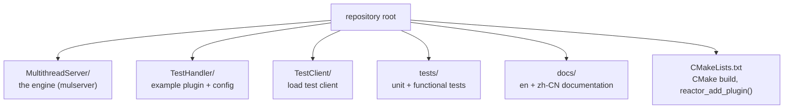
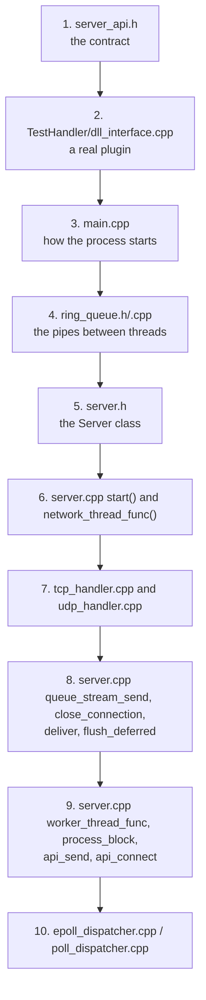
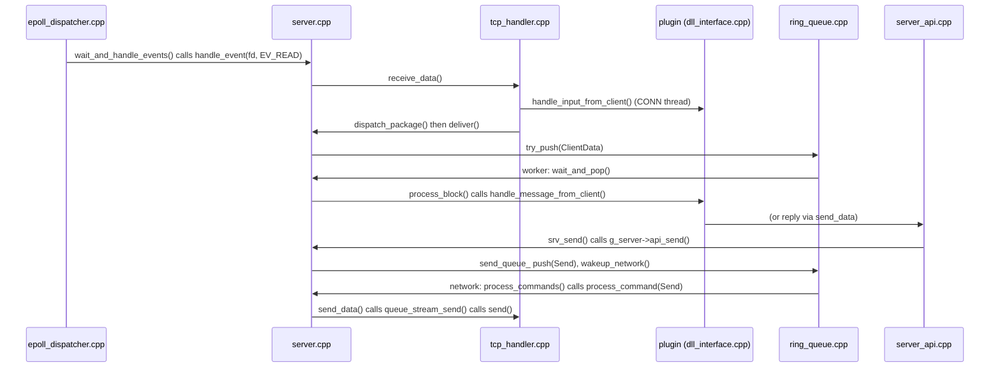

# Source code tour

**English** | [简体中文](../zh-CN/source-tour.md) · [README](../../README.md) · [Architecture](architecture.md) · [Plugin guide](plugin-guide.md) · [Configuration](configuration.md)

Every source file starts with a header comment explaining its role, and every function is documented
(what, why, parameters, return value). This page tells you where to start.

## Repository layout

## Engine files

| File | Role | Read it for |
|---|---|---|
| `server_api.h` | the public plugin API (C) | what a plugin can implement and call |
| `main.cpp` | process entry: config, logging, daemon, plugin, signals | the process life cycle |
| `server.h` / `server.cpp` | the core: threads, reactor loop, back pressure, plugin API implementation | **the heart of the engine** |
| `ring_queue.h` / `.cpp` | bounded queue of variable sized blocks between threads | lock + condition variable design, padding |
| `connection_manager.h` / `.cpp` | `Connection`, flags, `ByteBuffer`, fd → connection table | per-socket state |
| `protocol_handler.h` / `.cpp` | strategy interface for TCP vs UDP | |
| `tcp_handler.h` / `.cpp` | accept loop, `recv()`, framing (`split_packages`), EOF | stream handling |
| `udp_handler.h` / `.cpp` | datagrams on binds and on outbound sockets | datagram handling |
| `event_dispatcher.h` | strategy interface for readiness back ends | |
| `epoll_dispatcher.h` / `.cpp` | Linux epoll (level-triggered) | |
| `poll_dispatcher.h` / `.cpp` | portable `poll()` | |
| `event_dispatcher_factory.cpp` | picks epoll or poll from `event_engine` | |
| `server_api.cpp` | the exported `srv_*` functions, forwarding to `g_server` | how C functions reach the C++ object |
| `dll_functions.h` / `.cpp` | `dlopen` / `dlsym` of the plugin callbacks | dynamic loading |
| `configuration_manager.h` / `.cpp` | `key = value` parser | |
| `log_manager.h` / `.cpp` | thread safe logger with rotation | |
| `daemon_manager.h` / `.cpp` | signals, daemonizing, pid file | Unix process basics |
| `utility.h` / `.cpp` | address conversion, time, string helpers, fd flags | |
| `default_config.h` | default value of every config key | |

## Recommended reading order

## How a call travels through the files

Following one echo request through the code:

## Tests

| File | What it tests |
|---|---|
| `tests/ring_queue_test.cpp` | wrap-around with padding, full queue, many producers and consumers, payload integrity |
| `tests/run_tests.sh` | builds everything, runs the unit test, echo (TCP + UDP), relay, both event engines, and checks sanitizer output |
| `TestClient/main.cpp` | load generator: N clients, M messages, verifies every echoed payload |
