# 架构

[English](../en/architecture.md) | **简体中文** · [README](../../README.zh-CN.md) · [插件开发指南](plugin-guide.md) · [配置](configuration.md) · [源码导读](source-tour.md)

本文讲解 reactor 引擎的内部工作原理：哪个线程做什么，数据如何从 socket 流向你的插件、再流回去，
以及每个设计决策背后的原因。每一节都会指出实现它的函数，方便你对照图示阅读代码。

## 目录

1. [设计目标](#1-设计目标)
2. [线程与队列](#2-线程与队列)
3. [主要的类](#3-主要的类)
4. [启动流程](#4-启动流程)
5. [Reactor 循环](#5-reactor-循环)
6. [处理一个就绪的 socket](#6-处理一个就绪的-socket)
7. [TCP 客户端连接的一生](#7-tcp-客户端连接的一生)
8. [分包：从字节流到数据包](#8-分包从字节流到数据包)
9. [UDP](#9-udp)
10. [对外连接（srv_connect）](#10-对外连接srv_connect)
11. [发送路径](#11-发送路径)
12. [环形队列](#12-环形队列)
13. [背压](#13-背压)
14. [关注集合：epoll 在等待什么](#14-关注集合epoll-在等待什么)
15. [连接标识：为什么需要 conn_id](#15-连接标识为什么需要-conn_id)
16. [关闭连接](#16-关闭连接)
17. [Worker 循环与定时器](#17-worker-循环与定时器)
18. [超时](#18-超时)
19. [停止流程](#19-停止流程)
20. [日志、守护进程与信号](#20-日志守护进程与信号)

---

## 1. 设计目标

| 目标 | 实现方式 |
|---|---|
| 插件代码无需加锁 | 每个连接固定绑定到一个 worker；它的所有回调都在该 worker 上按顺序执行 |
| 绝不在网络上阻塞 | 单个网络线程，使用非阻塞 socket 和 epoll/poll；它从不在队列上等待 |
| 内存有上限 | 固定大小的环形队列、每个连接的 `send_buffer_max`、处处都有背压 |
| 低延迟 | 自管道唤醒：worker 的命令会被立即执行，而不是等到下一次 poll 超时 |
| 防止竞态 | 命令携带 `(fd, conn_id)`；针对已关闭连接的过期命令会被丢弃 |
| 易学易调试 | 代码量小，每个关注点只在一处实现，注释详细，同时提供 epoll 和 poll 两种后端 |

**黄金法则**：*只有网络线程才会接触 socket 和连接表。* 其他所有线程都通过队列与它通信。
这消除了几乎所有可能的竞态。

## 2. 线程与队列

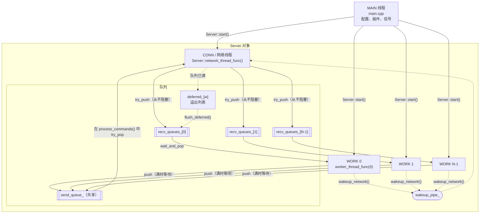

| 线程 | 运行的函数 | 是否接触 socket？ | 插件回调 |
|---|---|---|---|
| MAIN | `main()` | 仅在启动时（bind） | `handle_init(MAIN)`、`handle_fini(MAIN)` |
| CONN | `Server::network_thread_func()` | **是，全部 socket** | `handle_init(CONN)`、`handle_input_from_client/server`、`handle_fini(CONN)` |
| WORK × N | `Server::worker_thread_func(i)` | 仅在 `srv_connect()` 中创建 socket | 其余所有回调 |

为什么 **每个 worker 一个** 队列，而不是一个共享队列？如果使用共享队列，两个 worker 可能会分别取走
同一 TCP 连接的两条消息，并以错误的顺序处理它们。每个 worker 一个队列，再加上“连接 → worker”的
固定绑定，就天然保证了顺序。

为什么发送队列是 **共享** 的？所有 worker 的命令都发往同一个唯一的消费者（网络线程），而同一个
worker 的命令必须保持顺序（例如 `Register` 必须在 `Send` 之前，参见
[第 10 节](#10-对外连接srv_connect)）。一个 FIFO 队列可以同时保证这两点。

### 连接如何分配给 worker

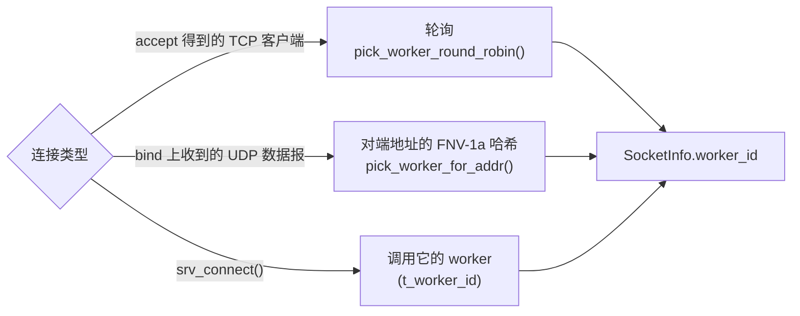

UDP 没有连接，因此由对端地址决定 worker。哈希是稳定的，所以同一个对端的所有数据报都会由同一个
worker 按顺序处理。

## 3. 主要的类

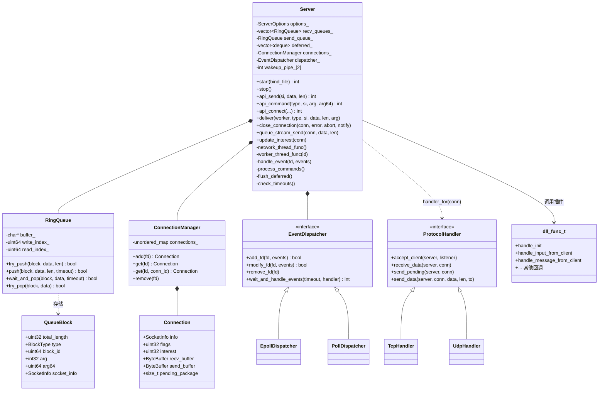

* 两处使用了 **策略模式**：`EventDispatcher` 屏蔽了 epoll 与 poll 的差异，`ProtocolHandler` 屏蔽了
  TCP 与 UDP 的差异。`Server` 的代码从不询问“这是 epoll 吗？”，而是交给策略对象去处理。
* `Connection` 是网络线程私有的 socket 视图（缓冲区、标志位）。`SocketInfo` 是公开的快照，
  会被复制到每个事件中并交给插件。

## 4. 启动流程

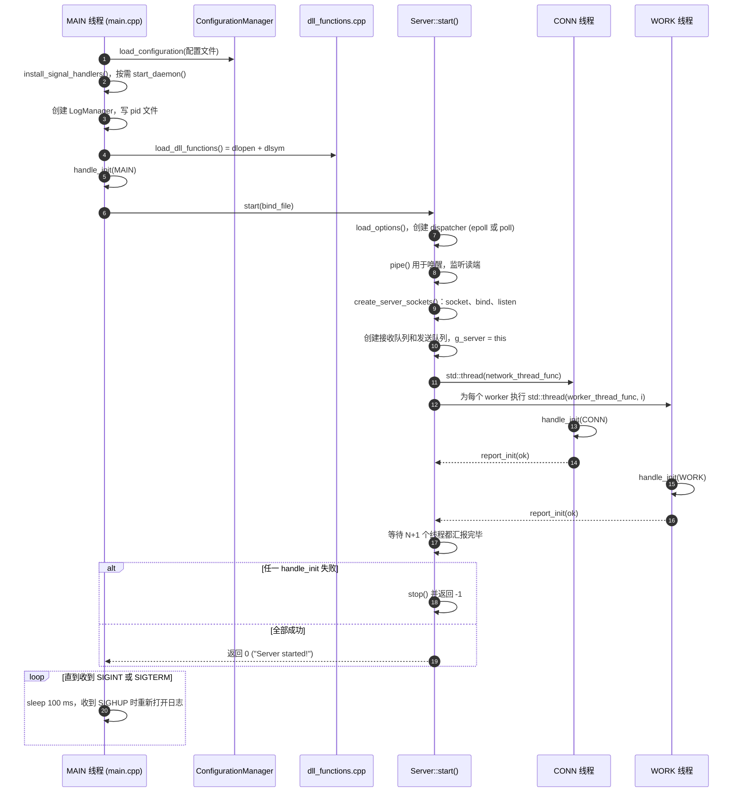

为什么要在启动线程 **之前** 执行 bind？这样像“端口已被占用”这类常见错误会立即失败，
此时还没有任何需要再停止的线程。

## 5. Reactor 循环

`Server::network_thread_func()` 是引擎的心脏。每一轮包含四个步骤：

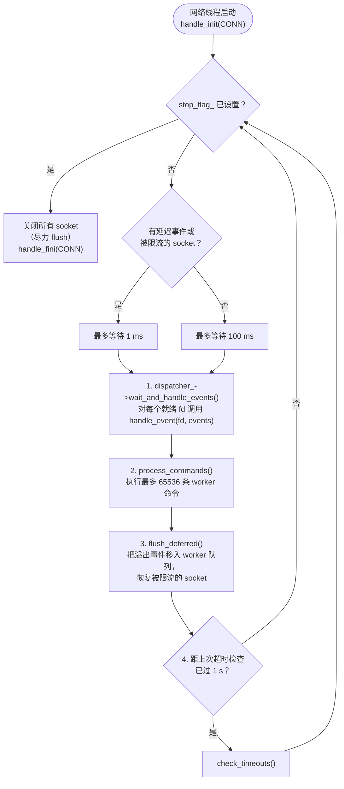

* **为什么超时是 100 ms？** 延迟并不依赖它（命令会通过管道唤醒循环）；它只是限定了超时和停止标志
  最晚多久会被发现。
* **为什么有积压时用 1 ms？** worker 腾出队列空间时不会通知网络线程，所以只要有东西在等待空间，
  网络线程就快速轮询。
* **为什么每轮最多处理 65536 条命令？** 插件疯狂塞满发送队列时，不能让 socket 事件（accept、read）
  被饿死。

### 自管道技巧

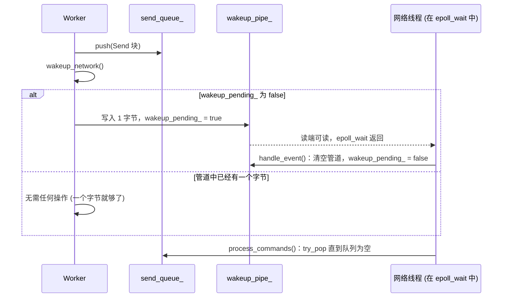

`epoll_wait()`/`poll()` 只能等待文件描述符，不能等待条件变量。向一个读端被监听的管道写入一个字节，
就把“有命令入队了”转换成了“某个 fd 变得可读”。原子标志 `wakeup_pending_` 避免了每条命令都触发一次
`write()` 系统调用。

## 6. 处理一个就绪的 socket

`Server::handle_event(fd, events)` 负责判断一个就绪事件意味着什么：

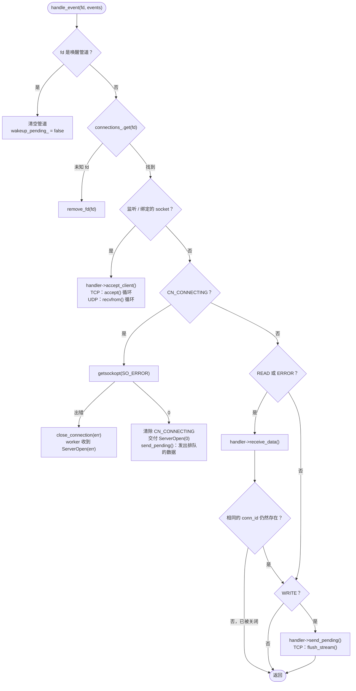

注意读取之后的 `conn_id` 检查：`receive_data()` 可能会关闭连接，而且在同一次调用中，这个 fd 编号
甚至可能已经被一个新连接复用。参见[第 15 节](#15-连接标识为什么需要-conn_id)。

## 7. TCP 客户端连接的一生

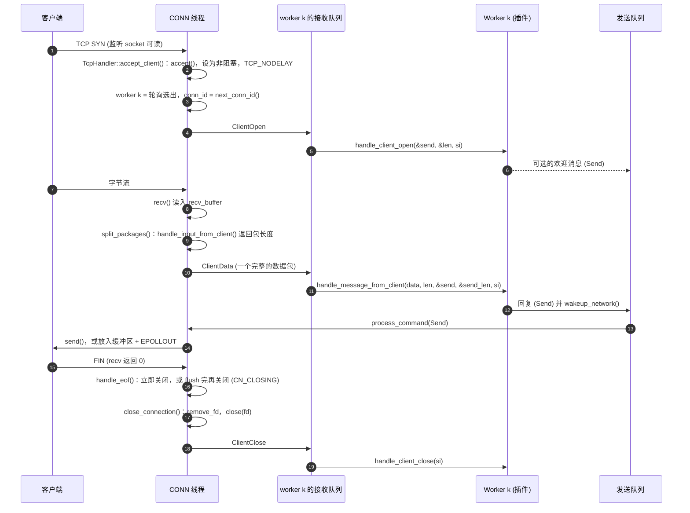

插件可以依赖的保证：

* 对每个被 accept 的连接，`handle_client_open` 和 `handle_client_close` 都 **恰好调用一次**，
  并且在同一个 worker 上，所有消息都在这两者之间到达。
* 针对已关闭连接的命令会被静默丢弃，因此“太晚”调用 `srv_send()` 是无害的。

## 8. 分包：从字节流到数据包

TCP 是字节流：一次 `recv()` 可能返回半条消息，也可能返回三条消息。插件的
`handle_input_from_client()` 告诉引擎一个数据包在哪里结束。`TcpHandler::split_packages()` 的流程：

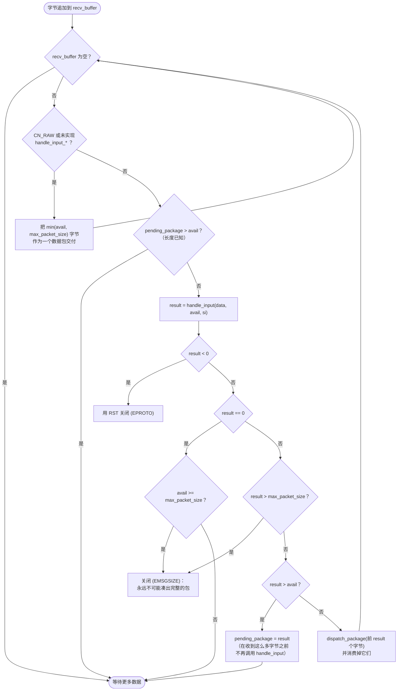

当包头中包含总长度时，允许并推荐返回 **大于 `len`** 的长度：引擎会把它记在 `pending_package` 中，
这样对于一条大消息，就不会在每收到一小块数据时都再调用一次插件。

## 9. UDP

bind 文件中的一行 “udp” 会创建一个绑定的 socket。UDP 没有针对每个对端的连接对象：

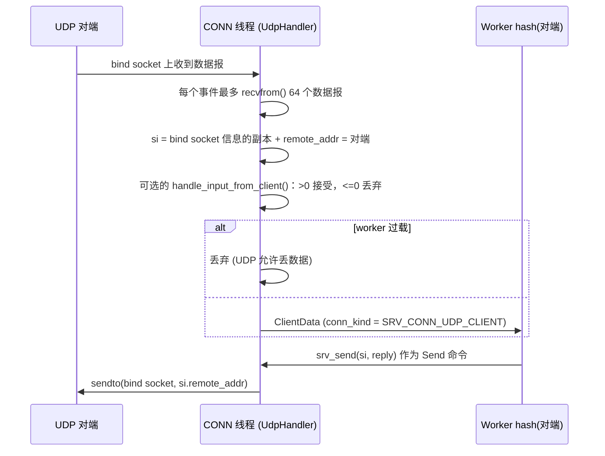

* UDP 对端没有 `handle_client_open/close`：因为根本没有连接。同一个 bind 上的所有对端共享该 bind
  socket 的 `sock_fd` 和 `conn_id`；请用 `si->remote_addr` 来标识一个 UDP 对端。
* 回复从 bind socket 发往 `si->remote_addr`（由 `process_command` 传入 `to`）。
* 当 worker 过载时，UDP 数据会被 **丢弃** 而不是缓冲 —— 这正是 UDP 的本性，也能保护服务器。
* 对外的数据报 socket（`srv_connect(SOCK_DGRAM / SOCK_RAW)`）是用 `recv()` 读取的“已连接” socket；
  每个数据报对应一个 `ServerData` 事件。

## 10. 对外连接（srv_connect）

`srv_connect()` **在调用它的 worker 线程中** 创建 socket，发起非阻塞的 `connect()`，然后通过
`Register` 命令把 fd 交给网络线程。为什么不让网络线程来创建？因为这样 worker 能立即拿到完整的
`SocketInfo`（fd + `conn_id`），可以马上 `srv_send()` 数据；又因为同一线程发出的命令保持有序，
`Register` 总是在这些 `Send` 命令之前执行。

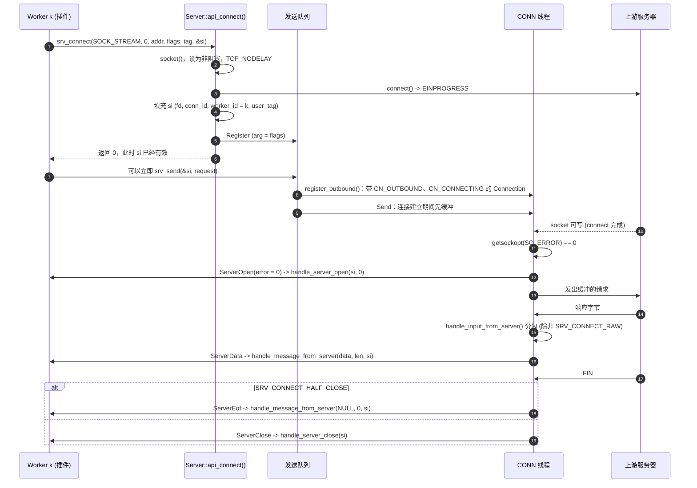

从插件视角看，对外连接的状态机如下：

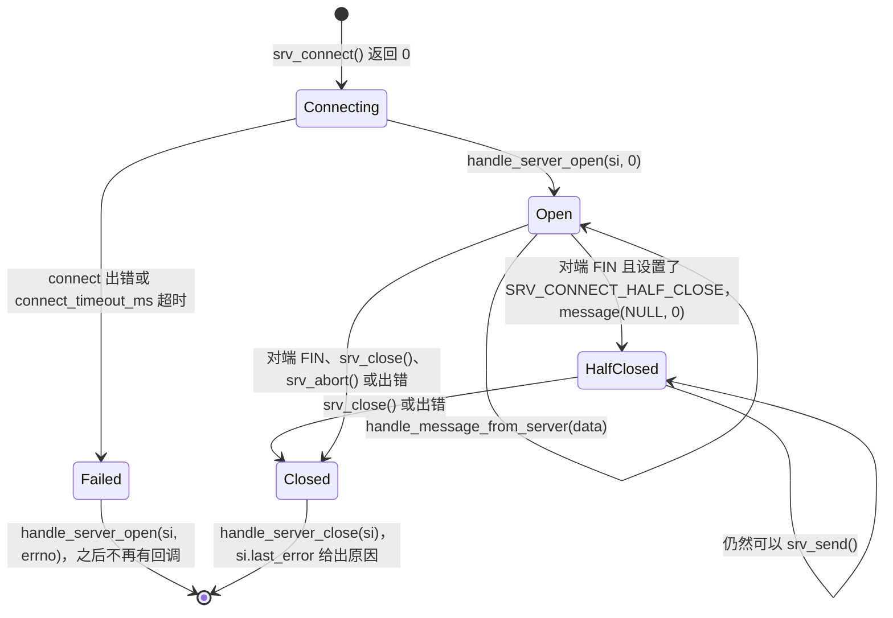

`srv_connect()` 不仅支持 TCP：

| sock_type / protocol | 用途 |
|---|---|
| `SOCK_STREAM, 0` | TCP 客户端 |
| `SOCK_DGRAM, 0` | 已连接的 UDP socket（每个数据报是一条消息） |
| `SOCK_DGRAM, IPPROTO_ICMP` | 无需特权的 ICMP “ping socket”（Linux 需配置 `net.ipv4.ping_group_range`，macOS） |
| `SOCK_RAW, IPPROTO_ICMP` | 原始 ICMP（需要 root / CAP_NET_RAW） |

`user_tag` 是附加在连接上的一个自由使用的 64 位值。relay 示例把客户端的 `conn_id` 存在这里，
以便 `handle_message_from_server` 能找到对应的客户端。

## 11. 发送路径

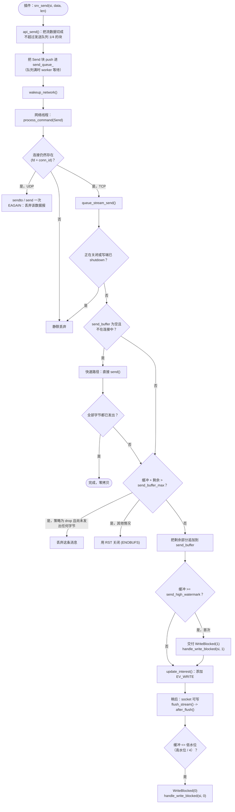

`after_flush()` 还会完成那些需要等待缓冲区清空的操作：

| 标志 | 由谁设置 | 缓冲区清空后执行 |
|---|---|---|
| `CN_CLOSING` | `srv_close()`、对端 FIN 时仍有待发数据 | `close_connection()` |
| `CN_SHUTDOWN_WR` | `srv_shutdown_write()` | `shutdown(SHUT_WR)` → 发出我方的 FIN，设置标志 `CN_WR_SHUT_DONE` |
| `CN_WRITE_BLOCKED` | 达到高水位 | 低于低水位时发出 `WriteBlocked(0)` |

## 12. 环形队列

`RingQueue`（`ring_queue.h/.cpp`）是一个有界的 FIFO，存放大小可变的块，所有块都存储在 **一块连续的
字节缓冲区** 中，该缓冲区只分配一次。每个块由一个 `QueueBlock` 头部和紧随其后的 payload 组成，
总长度向上对齐到 8 字节。

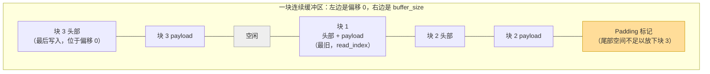

*回绕之后的缓冲区：块 3 放不进块 2 后面的空间，于是尾部被填上一个 Padding 标记，块 3 被写在偏移 0 处。
读取方会跳过这个标记。*

`write_index_` 和 `read_index_` 是只增不减的 64 位字节计数器；在缓冲区中的位置是
`index % buffer_size`，而 `write_index_ - read_index_` 就是已用空间。push 算法：

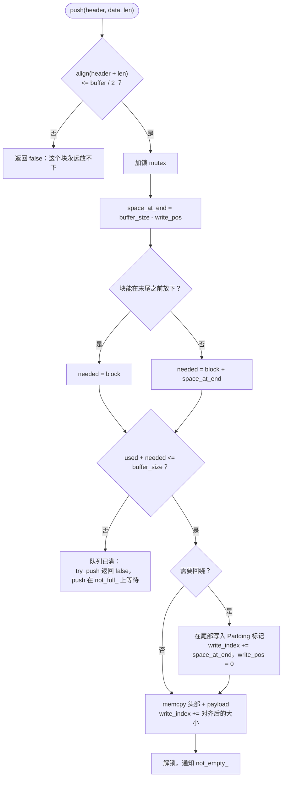

为什么每个块最多只能占缓冲区的 **一半**？最坏情况下，一个块需要它前面的填充空间再加上它自身的大小；
把块限制在缓冲区的一半以内，就能保证队列清空后任何块都一定能存进去。因此 `load_options()` 会让每个
队列至少为 `2 × (max_packet_size + header)`。

为什么要在 **解锁之后** 再通知？否则被唤醒的消费者会立刻阻塞在生产者仍然持有的 mutex 上。

## 13. 背压

快速的生产者绝不能让内存无限增长。引擎在多个层面上实现了背压：

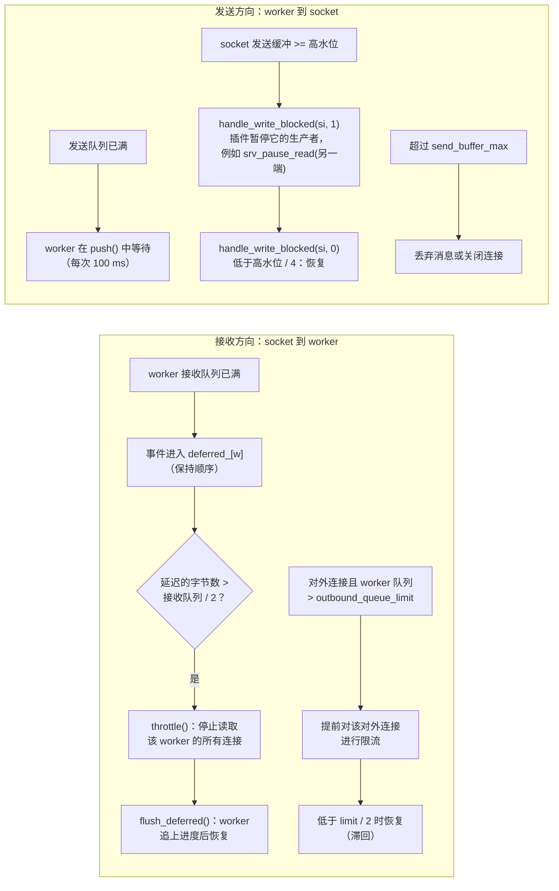

为什么要 **更早地** 对对外连接限流（`outbound_queue_limit`）？在代理中，上游服务器每秒可能推送数 MB
的数据，而客户端发送的是小消息（请求、经 VPN 转发的 TCP ACK）。如果没有这个提前的限制，这些对延迟
敏感的小客户端消息就会排在同一个 worker 队列中数 MB 服务器数据的后面（队头阻塞）。

relay 示例端到端地闭合了这个控制环：

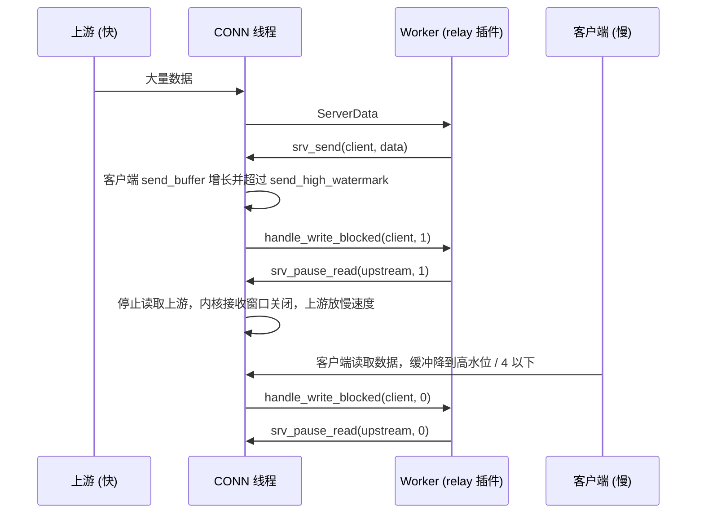

## 14. 关注集合：epoll 在等待什么

`Server::update_interest()` 是决定注册哪些事件的 **唯一** 位置。每当有状态变化时，都会根据连接状态
重新推导出这个集合：

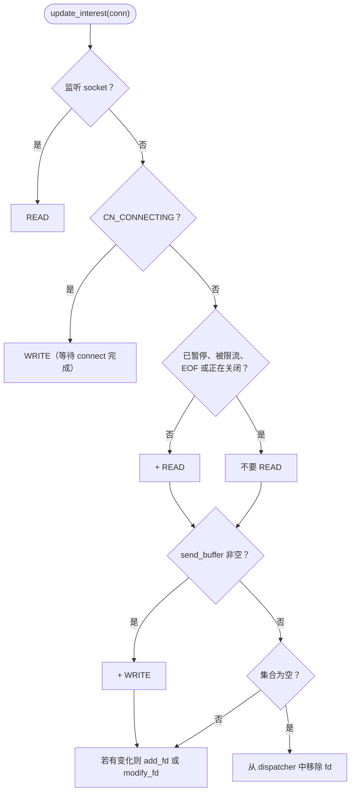

* 只在有未发送数据时才关注 WRITE：空闲的 socket *总是* 可写的，如果一直关注 WRITE，循环就会空转到
  100 % CPU。
* **空的** 关注集合会把 fd 从 epoll 中彻底移除。对于 epoll，即使没有请求，`EPOLLERR`/`EPOLLHUP`
  也总会被报告；否则一个我们不想再读的半关闭 socket 会无休止地唤醒循环。
* 两种后端都是水平触发的：只要条件仍然成立，事件就会被再次报告，因此处理函数可以提前停止
  （例如 accept 256 次之后）而不会丢失任何东西。

## 15. 连接标识：为什么需要 conn_id

内核会立即复用 fd 编号。worker 入队的一条命令，可能在它的连接已经关闭、并且同一个 fd 已经分配给新
客户端之后才到达：

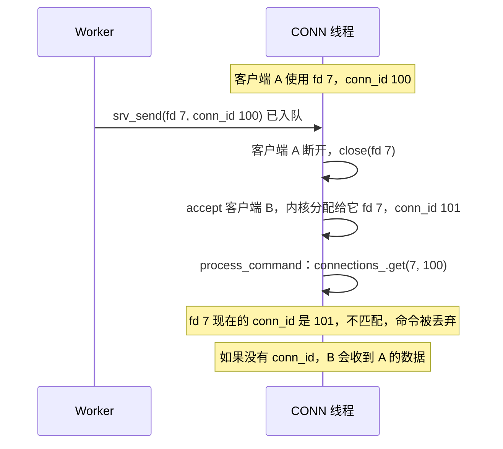

这就是为什么每条命令都使用 `ConnectionManager::get(fd, conn_id)`，为什么 `handle_event()` 在读取后
要重新检查，以及为什么插件必须用 `conn_id` 而不是 fd 作为表的键。

## 16. 关闭连接

`Server::close_connection()` 是关闭 socket 的唯一位置。它保证每个连接恰好收到一次“已关闭”通知：

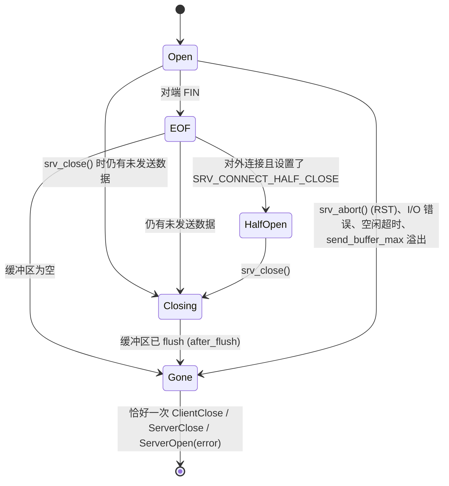

| 情形 | worker 收到的事件 |
|---|---|
| accept 得到的客户端被关闭 | `ClientClose` → `handle_client_close` |
| 对外连接在建立后被关闭 | `ServerClose` → `handle_server_close` |
| 对外连接的 connect 从未完成 | `ServerOpen(error)` → `handle_server_open(si, errno)` |
| 引擎停止 | 无（worker 正在停止） |

`srv_abort()` 会在 `close()` 之前设置超时为 0 的 `SO_LINGER`，这会让内核发送 TCP **RST** 并丢弃
未发送的数据，而不是走正常的 FIN 握手。

## 17. Worker 循环与定时器

```mermaid
flowchart TD
    S(["worker_thread_func(i)<br/>t_worker_id = i，handle_init(WORK)"]) --> L{"停止标志？"}
    L -->|"是"| F(["handle_fini(WORK)"])
    L -->|"否"| W["wait_ms = 距下一次定时器触发的时间（最大 100）"]
    W --> POP["recv_queue.wait_and_pop(wait_ms)"]
    POP -->|"取到事件"| PB["process_block()：调用对应的回调<br/>send_data 中的回复通过 api_send() 发送<br/>返回负值则生成 Close 命令"]
    POP -->|"超时"| T
    PB --> T{"定时器间隔已到？"}
    T -->|"是"| HT["handle_timer(&ms)<br/>插件可以修改间隔"]
    T -->|"否"| L
    HT --> L
```

| 事件类型 | 回调 |
|---|---|
| `ClientOpen` | `handle_client_open(&send, &send_len, si)` |
| `ClientData` | `handle_message_from_client(data, len, &send, &send_len, si)` |
| `ClientClose` | `handle_client_close(si)` |
| `ServerOpen` | `handle_server_open(si, error)` |
| `ServerData` | `handle_message_from_server(data, len, si)` |
| `ServerEof` | `handle_message_from_server(NULL, 0, si)` |
| `ServerClose` | `handle_server_close(si)` |
| `WriteBlocked` | `handle_write_blocked(si, blocked)` |

## 18. 超时

`check_timeouts()` 在网络线程上大约每秒运行一次：

* **连接超时** —— 一个对外 socket 在 `connect_timeout_ms` 之后仍处于 `CN_CONNECTING` 状态，就会以
  `ETIMEDOUT` 关闭（插件收到 `handle_server_open(si, ETIMEDOUT)`）。
* **空闲超时** —— 一个 accept 得到的客户端，如果在该 bind 的空闲超时时间内（bind 文件第四列，单位秒，
  0 = 永不超时）没有收到任何数据，就会以 `ETIMEDOUT` 关闭。

即使有数万个连接，每秒一次的线性扫描开销也很小，而且比时间轮简单得多。

## 19. 停止流程

```mermaid
sequenceDiagram
    autonumber
    participant OS as 信号 (SIGINT 或 SIGTERM)
    participant M as MAIN 线程
    participant S as Server::stop()
    participant N as CONN 线程
    participant W as WORK 线程
    OS->>M: 信号处理函数设置 stop_signal = 1
    M->>S: server.stop()
    S->>S: started_.exchange(false) (幂等)
    S->>S: stop_flag_ = true
    S->>N: wakeup_network()
    N->>N: 循环结束，flush 发送缓冲 (尽力而为)
    N->>N: 关闭所有 socket，不再向 worker 发送事件
    N->>N: handle_fini(CONN)
    S->>N: join()
    S->>W: 对每个队列 notify_all()
    W->>W: 循环结束，handle_fini(WORK)
    S->>W: join()
    M->>M: handle_fini(MAIN)，删除 pid 文件，退出
```

网络线程 **最先** 停止，这样就不会再为正在退出的 worker 产生新事件。插件被有意地不执行
`dlclose()`：插件注册的 `thread_local` 析构函数可能在进程退出时仍会运行。

## 20. 日志、守护进程与信号

```mermaid
flowchart LR
    A["引擎或插件中的 LOG_INFO(...)"] --> B{"level <= log_level？"}
    B -->|"否"| X["忽略（LOG_DEBUG / LOG_TRACE<br/>完全跳过格式化）"]
    B -->|"是"| C["格式化：时间、级别、线程名"]
    C --> D{"log_dest"}
    D -->|"1"| T["终端"]
    D -->|"2"| F["文件 log_dir/prefix + server.log"]
    D -->|"3"| T & F
    F --> R{"文件 > log_size？"}
    R -->|"是"| ROT["轮转：server.log.1 ... log_maxfiles"]
```

* `run_mode = background` 会在创建任何线程之前，用经典的 **两次 fork + setsid()** 变成守护进程
  （对多线程进程执行 fork 只会复制调用 fork 的那个线程）。
* 信号：`SIGINT`/`SIGTERM` 设置一个由主线程轮询的标志，`SIGHUP` 重新打开日志文件（用于配合外部日志
  轮转），`SIGPIPE` 被忽略，这样向已关闭的 socket 写数据会返回 `EPIPE`，而不是杀死进程。
* 每个线程都有名字（`main`、`conn`、`work-0` …），并出现在每一行日志中，便于看出哪个线程做了什么。
