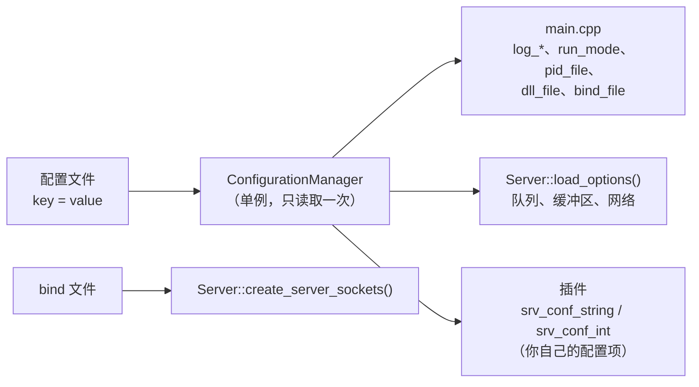

# 配置

[English](../en/configuration.md) | **简体中文** · [README](../../README.zh-CN.md) · [架构](architecture.md) · [插件开发指南](plugin-guide.md) · [源码导读](source-tour.md)

## 命令行

```bash
mulserver [config_file] [plugin_path]
mulserver -h
```

| 参数 | 默认值 | 含义 |
|---|---|---|
| `config_file` | `./config.ini` | 配置文件（格式见下文） |
| `plugin_path` | 配置中的 `dll_file`，否则为 `./libhandler.so` | 插件共享库 |

所有参数也会传给每一次 `handle_init(argc, argv, thread_type)` 调用。

## 配置是如何被使用的



配置文件只在 **启动时读取一次**；修改后需要重启。插件可以从同一个文件中读取自己的配置项，
因此一个文件就能同时配置引擎和业务逻辑。

## 文件格式

```ini
# 注释（'#' 或 ';' 位于行首或空白字符之后）
[section]            ; section 头会被忽略（所有键都是全局的）
key = value          # '=' 两边的空格会被去掉
worker_num = 0x10    # 整数支持十进制、0x 十六进制和 0 开头的八进制（strtoll base 0）
tcp_nodelay = yes    # 布尔值：1 / true / yes / on，其他任何值都为 false
```

## 配置项

### 日志

| 配置项 | 默认值 | 含义 |
|---|---|---|
| `log_dir` | `./log` | 日志目录（不存在时自动创建） |
| `log_level` | `6` | 0 emerg，1 alert，2 crit，3 error，4 warn，5 notice，6 info，7 debug，8 trace |
| `log_dest` | `3` | 1 终端，2 文件，3 两者都输出 |
| `log_size` | `104857600`（100 MB） | 文件超过该大小时轮转 |
| `log_maxfiles` | `10` | 保留的轮转文件数：`server.log.1` … |
| `log_prefix` | 空 | 文件名变为 `<prefix>server.log` |

### 进程

| 配置项 | 默认值 | 含义 |
|---|---|---|
| `run_mode` | `foreground` | `background` = 守护进程（两次 fork + setsid） |
| `pid_file` | 空 | 把 pid 写到这里（退出时删除） |
| `worker_num` | `4` | worker 线程数（至少为 1） |
| `bind_file` | `./conf/bind.txt` | 监听地址（见下文） |
| `dll_file` | `./libhandler.so` | 插件，命令行未指定时使用 |

### 队列与缓冲区

| 配置项 | 默认值 | 含义 |
|---|---|---|
| `max_packet_size` | `65536` | 最大的数据包 / 消息（1 B … 64 MB） |
| `ringqueue_length` | `8388608`（8 MB） | **每个** worker 的接收队列字节数 |
| `send_queue_length` | `16777216`（16 MB） | 共享的 worker → 网络线程命令队列的字节数 |
| `recv_buffer` | `65536` | 每次 `recv()` 调用读取的字节数（至少 1024） |
| `send_buffer_max` | `67108864`（64 MB） | 每个连接允许的未发送字节数 |
| `send_overflow_policy` | `close` | 超过 `send_buffer_max` 时：`close` 关闭连接，或 `drop` 丢弃消息 |
| `send_high_watermark` | `1048576`（1 MB） | 超过它时调用 `handle_write_blocked(si, 1)`，低于它的四分之一时调用 `(si, 0)` |
| `outbound_queue_limit` | `1048576`（1 MB） | 当对外连接所属 worker 的队列积压超过该值时，停止读取这些对外连接 |

两个队列的大小都会被自动提升到至少 `2 × (max_packet_size + header) + 4096`，因为一个块最多只能占用
环形队列的一半（参见[架构 § 12](architecture.md#12-环形队列)）。

### 网络

| 配置项 | 默认值 | 含义 |
|---|---|---|
| `listen_backlog` | `1024` | `listen()` 的 backlog |
| `connect_timeout_ms` | `10000` | `srv_connect()` 的超时时间 |
| `tcp_nodelay` | `1` | 在 accept 得到的和对外的 TCP socket 上禁用 Nagle 算法 |
| `max_connections` | `100000` | 超过该数量后新 accept 的客户端会被立即关闭 |
| `timer_interval_ms` | `100` | `handle_timer` 的默认周期 |
| `event_engine` | Linux 上为 `epoll`，其他平台为 `poll` | 就绪通知后端 |

## Bind 文件

每行一个监听地址：`ip port tcp|udp [idle_timeout_seconds]`。

```text
#ip          #port   #type   #idle timeout (seconds, 0 = never)
0.0.0.0      12345   tcp     60
0.0.0.0      12345   udp     0
::           12345   tcp     60
```

* `::` 只绑定 IPv6（`IPV6_V6ONLY`），因此 `0.0.0.0` 可以单独绑定到同一个端口。
* 空闲超时作用于该行 accept 得到的 TCP 客户端。
* 每个 socket 都会设置 `SO_REUSEADDR`，这样即使旧连接还处于 `TIME_WAIT` 状态也能重启。

## 信号

| 信号 | 效果 |
|---|---|
| `SIGINT`、`SIGTERM` | 优雅停止（参见[架构 § 19](architecture.md#19-停止流程)） |
| `SIGHUP` | 重新打开日志文件（用于外部日志轮转之后，例如 logrotate） |
| `SIGPIPE` | 忽略（向已关闭的 socket 写入会返回 `EPIPE`） |

## 日志行格式

```text
[2026-10-12 10:00:00.123] [INFO] [work-2] Worker 2 processed 1000 messages
 时间戳                    级别   线程     消息
```

线程名：`main`、`conn`、`work-0` … `work-N-1`。

## 调优建议

| 现象 | 可以尝试 |
|---|---|
| trace 日志中出现 "Worker N queue full, deferred" | 增加 worker、让插件更快，或增大 `ringqueue_length` |
| 代理的客户端在下载时延迟很高 | 调低 `outbound_queue_limit` |
| 连接因 `ENOBUFS` 被关闭 | 对端读得太慢：响应 `handle_write_blocked`，或调大 `send_buffer_max` |
| macOS 上连接数很多 | 在那里 `event_engine = poll` 是唯一选择；请控制连接数在适中范围 |
| 调试 | `log_level = 8`、`worker_num = 1`、`log_dest = 1` |
