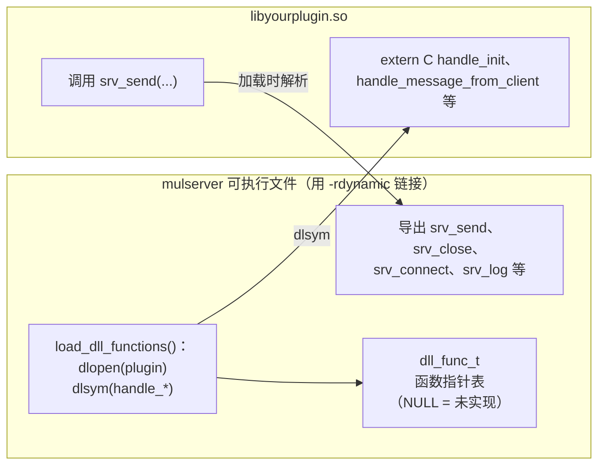
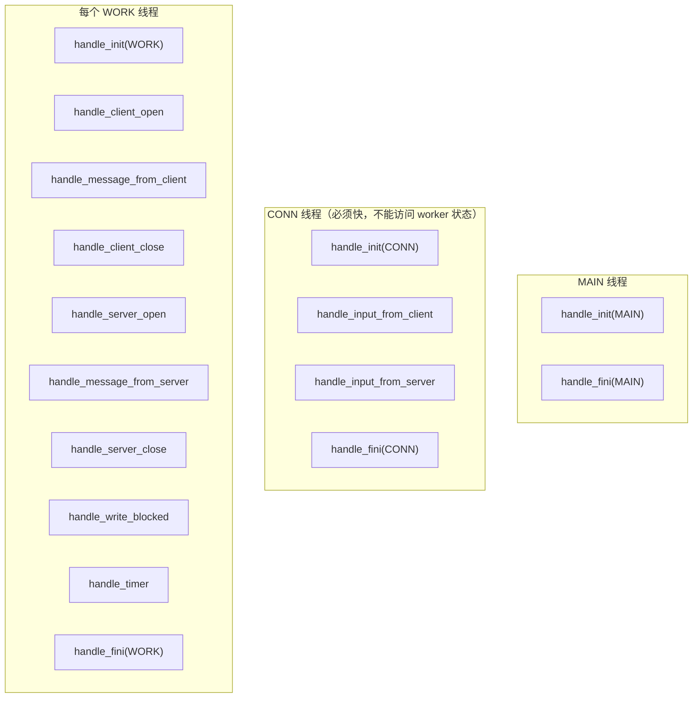
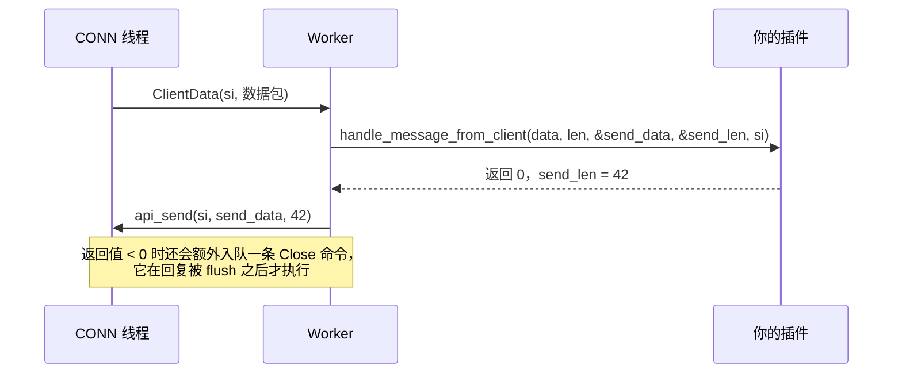
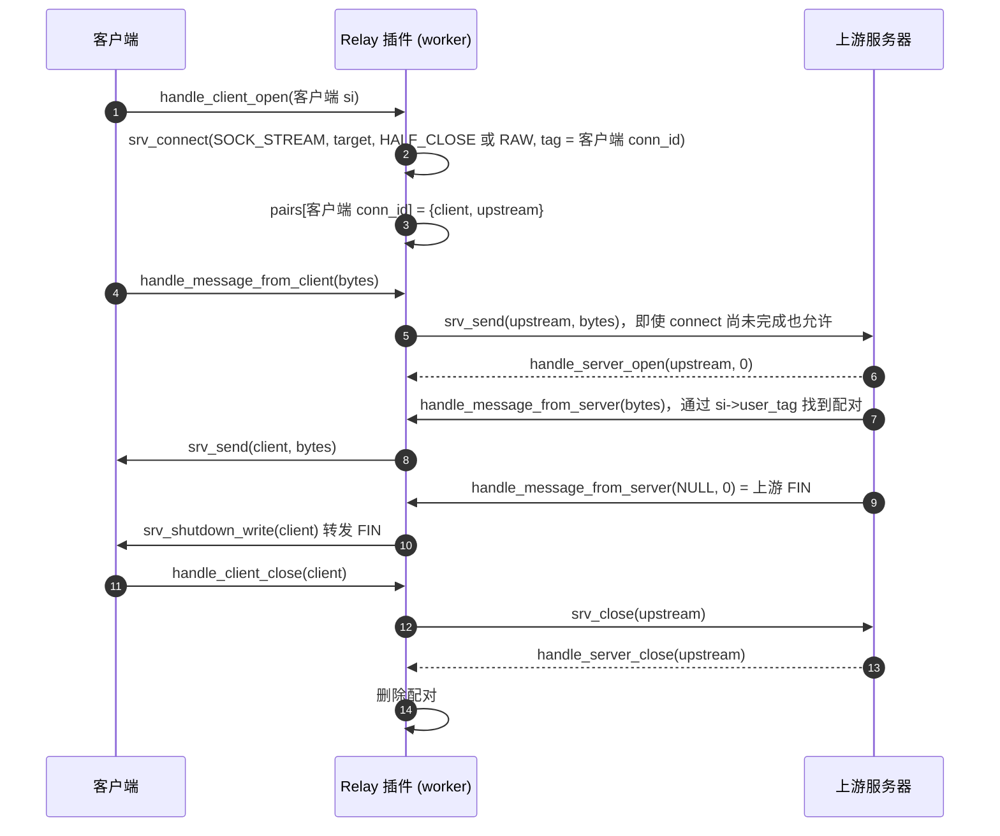

# 插件开发指南

[English](../en/plugin-guide.md) | **简体中文** · [README](../../README.zh-CN.md) · [架构](architecture.md) · [配置](configuration.md) · [源码导读](source-tour.md)

插件是一个由引擎通过 `dlopen()` 加载的共享库。你只需把业务逻辑写成几个 C 回调，其余一切都由引擎完成。
本指南将一步步构建一个插件，并讲解你必须了解的规则。

## 1. 引擎和插件如何找到彼此



* 回调必须声明为 `extern "C"`，这样它们的名字不会被 C++ 名字修饰（name mangling），`dlsym()` 才能找到它们。
* `srv_*` 函数位于可执行文件中。`-rdynamic`（CMake：`ENABLE_EXPORTS ON`）会把它们放进动态符号表，
  插件才能调用它们。出于同样的原因，在 macOS 上插件使用 `-undefined dynamic_lookup` 链接。
* 未实现的回调在表中就是 `NULL`，会被直接跳过。只有 `handle_message_from_client` 是必须实现的。

## 2. 哪个回调在哪里运行



由此得出的规则：

1. `handle_input_*` 运行在网络线程上。让它尽量简短（只看包头），并且不要访问每个 worker 的状态。
2. 一个连接的所有事情都发生在 **同一个** worker 上。把每个连接的状态放在一个以 `conn_id` 为键的
   `thread_local` 表中 —— 不需要 mutex。
3. 在 `handle_init(MAIN)` 中（在任何其他线程启动之前）写入的全局状态，可以被所有线程无锁读取。

## 3. 第 1 步 —— 分包

先决定数据包在网络上的格式。测试插件使用 `[uint32 总长度][uint32 seq][payload]`，均为网络字节序。
然后告诉引擎一个数据包在哪里结束：

```cpp
extern "C" int handle_input_from_client(const char* data, int len, const SocketInfo* si) {
    if (len < 8) return 0;                       // 包头还不完整：等待
    uint32_t total;
    memcpy(&total, data, 4);                     // 用 memcpy：data 可能未对齐
    total = ntohl(total);                        // 网络字节序 -> 主机字节序
    if (total < 8 || total > (uint32_t)srv_max_packet_size())
        return -1;                               // 垃圾数据：引擎会关闭连接
    return (int)total;                           // 可以大于 len
}
```

| 返回值 | 含义 |
|---|---|
| `> 0` | 第一个完整数据包的长度（可以超过 `len`：引擎会等待剩余部分） |
| `0` | 数据还不够，暂时无法判断 |
| `< 0` | 协议错误，用 RST 关闭连接 |

对于 **UDP** bind，每个数据报调用一次：返回 `> 0` 表示接受（返回更小的值会截断数据报），
`<= 0` 表示丢弃。如果完全不实现它，那么每次 `read()` 读到的数据块就是一个数据包 —— 这对纯字节转发很有用。

## 4. 第 2 步 —— 处理消息

```cpp
extern "C" int handle_message_from_client(const char* data, int len, char** send_data, int* send_len,
                                          const SocketInfo* si) {
    // 方式 A：把回复写进引擎提供的缓冲区（srv_max_packet_size() 字节）
    memcpy(*send_data, data, len);
    *send_len = len;
    // 方式 B：让 *send_data 指向你自己的内存：*send_data = my_buf; *send_len = n;
    // 方式 C：调用 srv_send(si, ...) 任意多次（也可以稍后在其他回调中调用）
    return 0;                                    // < 0：回复发送完毕后关闭连接
}
```



## 5. 第 3 步 —— 每个 worker 各自的连接状态

```cpp
namespace {
struct Session { uint64_t bytes = 0; };
thread_local std::unordered_map<uint64_t, Session>* t_sessions;   // conn_id -> 状态
}

extern "C" int handle_init(int, char**, int thread_type) {
    if (thread_type == SRV_THREAD_WORK) t_sessions = new std::unordered_map<uint64_t, Session>();
    return 0;
}
extern "C" int handle_client_open(char**, int*, const SocketInfo* si) {
    (*t_sessions)[si->conn_id] = Session();
    return 0;                                    // < 0 表示拒绝该客户端
}
extern "C" int handle_client_close(const SocketInfo* si) {
    t_sessions->erase(si->conn_id);              // 对每个已建立的客户端恰好调用一次
    return 0;
}
extern "C" void handle_fini(int thread_type) {
    if (thread_type == SRV_THREAD_WORK) { delete t_sessions; t_sessions = nullptr; }
}
```

为什么在 `handle_init` 中创建一个指针，而不是直接用一个 `thread_local` map？这样插件可以精确地决定
状态在何时创建和销毁（在该线程的 `handle_init`/`handle_fini` 中），从而让停止时的顺序是确定的。

## 6. 第 4 步 —— 与其他服务器通信

`srv_connect()` 会创建一个归调用它的 worker 所有的对外连接。
[`TestHandler/dll_interface.cpp`](../../TestHandler/dll_interface.cpp) 中的 `relay` 模式用大约 100 行
代码实现了一个完整的透明 TCP 代理：



其中展示的关键技巧：

* `user_tag` 把对外连接关联回它的客户端。
* `SRV_CONNECT_RAW`：上游不做分包，每次读到的数据原样转发。
* `SRV_CONNECT_HALF_CLOSE`：上游的 FIN 会变成 `handle_message_from_server(NULL, 0)`，这样就可以用
  `srv_shutdown_write()`（TCP 半关闭）把它转发出去，而不必把整条链路拆掉。
* `handle_write_blocked` + `srv_pause_read` 实现端到端的流量控制（参见
  [架构 § 13](architecture.md#13-背压)）。

## 7. 第 5 步 —— 定时器

```cpp
extern "C" int handle_timer(int* ms) {
    // 输入时 *ms：距上一次调用经过的毫秒数
    expire_old_sessions();
    *ms = 1000;          // 可选：要求 1 s 后再调用（默认为 timer_interval_ms）
    return 0;
}
```

`handle_timer` 在 **每个** worker 中都会运行，因此每个 worker 都可以清理它自己的 `thread_local` 状态。

## 8. 编译插件

```bash
# Makefile 方式（参见 TestHandler/Makefile）
g++ -std=c++11 -fPIC -shared -I../MultithreadServer my_plugin.cpp -o libmyplugin.so

# CMake 方式，在另一个项目中
add_subdirectory(path/to/simple-cplusplus-multithread-reactor-server)
reactor_add_plugin(myplugin my_plugin.cpp)
```

然后在配置中写上 `dll_file = ./libmyplugin.so`（或者作为第二个命令行参数传入），再启动 `mulserver`。

## 9. 常见错误检查清单

| 错误 | 后果 | 正确做法 |
|---|---|---|
| 用 `si->sock_fd` 作为状态的键 | 已关闭连接的数据会串到新连接上 | 用 `si->conn_id` 作为键 |
| 用 `conn_id` 作为 UDP 对端的键 | 同一个 UDP bind 上的所有对端共享该 bind 的 `conn_id` | 用 `si->remote_addr` 作为 UDP 对端的键 |
| 在回调中阻塞（sleep、阻塞式数据库调用） | 该 worker 上的所有连接都会卡住 | 保持回调简短；把慢操作挪到别处 |
| 在 `handle_input_*` 中做重活 | 整个网络线程卡住 | 那里只解析包头 |
| 忘记 `extern "C"` | 找不到回调，被静默忽略 | 所有回调都声明为 `extern "C"` |
| 在代理中忽略 `handle_write_blocked` | 内存一直增长到 `send_buffer_max`，然后连接被关闭 | 用 `srv_pause_read` 暂停生产者 |
| 读取超出数据包的 `len` 字节 | 未定义行为 | 引擎每次调用只给出恰好一个数据包 |
| 保存 `SocketInfo*` 指针 | 它指向一个会被复用的缓冲区 | 复制结构体（`SocketInfo copy = *si`） |

## 10. API 参考

所有 `srv_*` 函数都是线程安全的。发送和关闭都是 **异步** 的：它们被放入网络线程的队列，并按调用线程
发出的顺序执行。

| 函数 | 返回值 | 说明 |
|---|---|---|
| `srv_send(si, data, len)` | 0 已入队 / -1 | 超过发送队列四分之一的 TCP 数据会被拆分（对端无感知）。数据报永远不会被拆分 |
| `srv_close(si)` | 0 / -1 | 所有排队的数据发完后关闭 |
| `srv_abort(si)` | 0 / -1 | 丢弃排队的数据，TCP RST |
| `srv_shutdown_write(si)` | 0 / -1 | flush 之后半关闭 |
| `srv_pause_read(si, paused)` | 0 / -1 | 1 = 停止读取，0 = 恢复 |
| `srv_set_user_tag(si, tag)` | 0 / -1 | 之后的事件会带上 `si->user_tag = tag` |
| `srv_connect(type, proto, addr, flags, tag, &si)` | 0 / -errno | 只能在 worker 线程中调用（在 CONN 线程中调用返回 `-EPERM`） |
| `srv_log(level, fmt, ...)`、`srv_log_enabled(level)` | | 级别从 `SRV_LOG_EMERG` (0) 到 `SRV_LOG_TRACE` (8) |
| `srv_conf_string(key, def)`、`srv_conf_int(key, def)` | 配置值 | 配置文件中的任意键 |
| `srv_worker_id()` | 0..N-1，-1 | 在 worker 线程之外返回 -1 |
| `srv_worker_count()`、`srv_max_packet_size()` | int | |
| `srv_addr_to_string(addr, buf, len)` | `buf` | `1.2.3.4:80` 或 `[::1]:80` |
| `srv_addr_from_string(ip, port, &addr)` | 0 / -1 | IPv4 或 IPv6 |

`SocketInfo` 字段：

| 字段 | 含义 |
|---|---|
| `sock_fd` | socket fd（对于 UDP 客户端：bind socket） |
| `socket_type` | `SOCK_STREAM`、`SOCK_DGRAM`、`SOCK_RAW` |
| `conn_kind` | `SRV_CONN_TCP_CLIENT`、`SRV_CONN_UDP_CLIENT`、`SRV_CONN_TCP_SERVER`、`SRV_CONN_DGRAM_SERVER` |
| `listen_fd` | 客户端来自哪个 bind socket，否则为 -1 |
| `worker_id` | 拥有该连接的 worker |
| `last_error` | 导致关闭的 errno（0 = 正常关闭） |
| `conn_id` | 在进程生命周期内唯一的 id —— **请用它作为键** |
| `user_tag` | 你通过 `srv_connect` / `srv_set_user_tag` 设置的值 |
| `create_timestamp`、`recv_timestamp`、`send_timestamp` | 自 epoch 起的秒数 |
| `local_addr`、`remote_addr` | `NetAddr`（IPv4 或 IPv6） |
| `local_ip`、`local_port`、`remote_ip`、`remote_port` | 主机字节序的 IPv4 便捷副本（IPv6 时为 0） |
