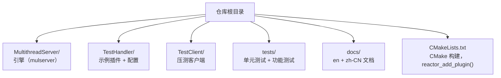
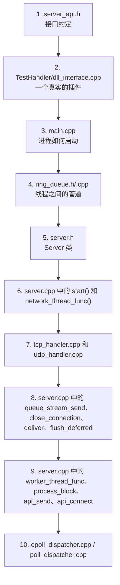
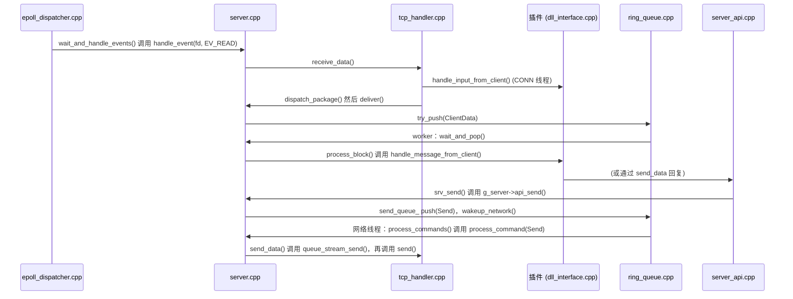

# 源码导读

[English](../en/source-tour.md) | **简体中文** · [README](../../README.zh-CN.md) · [架构](architecture.md) · [插件开发指南](plugin-guide.md) · [配置](configuration.md)

每个源文件开头都有一段说明其职责的头部注释，每个函数也都有文档注释（做什么、为什么、参数、返回值）。
本页告诉你应该从哪里开始读。

## 仓库结构

## 引擎文件

| 文件 | 职责 | 读它可以了解 |
|---|---|---|
| `server_api.h` | 公开的插件 API（C） | 插件可以实现和调用什么 |
| `main.cpp` | 进程入口：配置、日志、守护进程、插件、信号 | 进程的生命周期 |
| `server.h` / `server.cpp` | 核心：线程、reactor 循环、背压、插件 API 的实现 | **引擎的心脏** |
| `ring_queue.h` / `.cpp` | 线程之间的有界队列，存放大小可变的块 | 锁 + 条件变量的设计、填充（padding） |
| `connection_manager.h` / `.cpp` | `Connection`、标志位、`ByteBuffer`、fd → 连接表 | 每个 socket 的状态 |
| `protocol_handler.h` / `.cpp` | 区分 TCP 与 UDP 的策略接口 | |
| `tcp_handler.h` / `.cpp` | accept 循环、`recv()`、分包（`split_packages`）、EOF | 流的处理 |
| `udp_handler.h` / `.cpp` | bind 上和对外 socket 上的数据报 | 数据报的处理 |
| `event_dispatcher.h` | 就绪通知后端的策略接口 | |
| `epoll_dispatcher.h` / `.cpp` | Linux epoll（水平触发） | |
| `poll_dispatcher.h` / `.cpp` | 可移植的 `poll()` | |
| `event_dispatcher_factory.cpp` | 根据 `event_engine` 选择 epoll 或 poll | |
| `server_api.cpp` | 导出的 `srv_*` 函数，转发给 `g_server` | C 函数如何调用到 C++ 对象 |
| `dll_functions.h` / `.cpp` | 用 `dlopen` / `dlsym` 加载插件回调 | 动态加载 |
| `configuration_manager.h` / `.cpp` | `key = value` 解析器 | |
| `log_manager.h` / `.cpp` | 带轮转功能的线程安全日志器 | |
| `daemon_manager.h` / `.cpp` | 信号、守护进程化、pid 文件 | Unix 进程基础 |
| `utility.h` / `.cpp` | 地址转换、时间、字符串辅助函数、fd 标志 | |
| `default_config.h` | 每个配置项的默认值 | |

## 推荐阅读顺序

## 一次调用如何穿过各个文件

跟随一个 echo 请求走一遍代码：

## 测试

| 文件 | 测试内容 |
|---|---|
| `tests/ring_queue_test.cpp` | 带填充的回绕、队列满、多生产者多消费者、payload 完整性 |
| `tests/run_tests.sh` | 编译所有内容，运行单元测试、echo（TCP + UDP）、relay（TCP + UDP）、两种事件引擎，并检查 sanitizer 输出 |
| `tests/udp_empty_test.py` | 上游回复的空 UDP 数据报以空包（而不是 EOF）的形式到达客户端 |
| `TestClient/main.cpp` | 负载生成器：N 个客户端，每个 M 条消息，校验每个回显的 payload |
